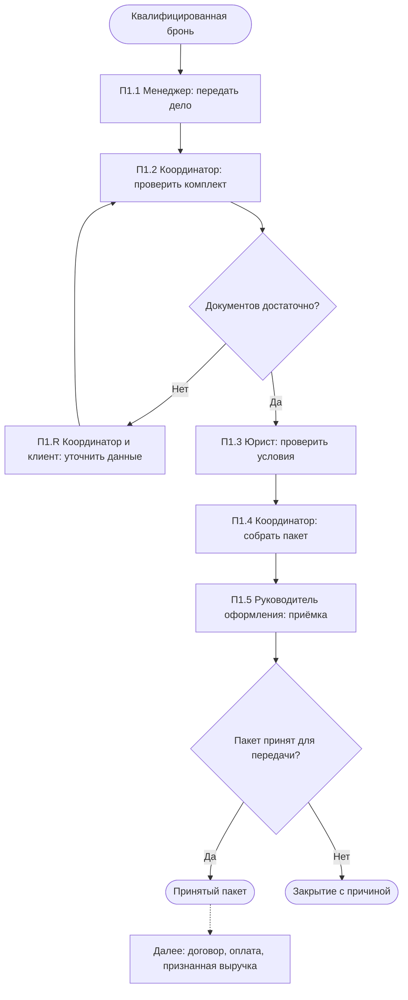
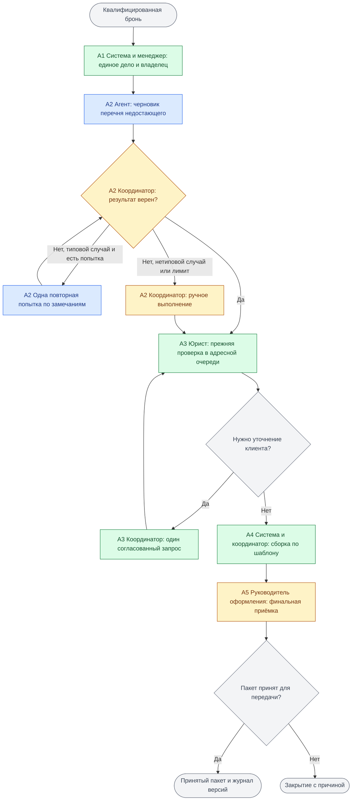
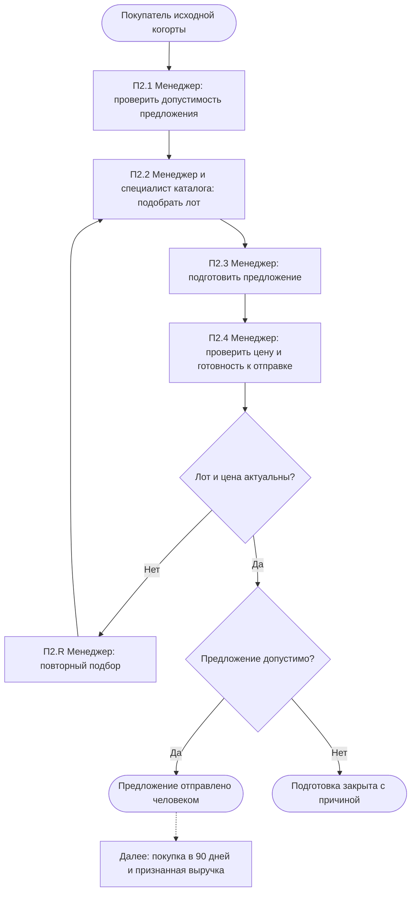
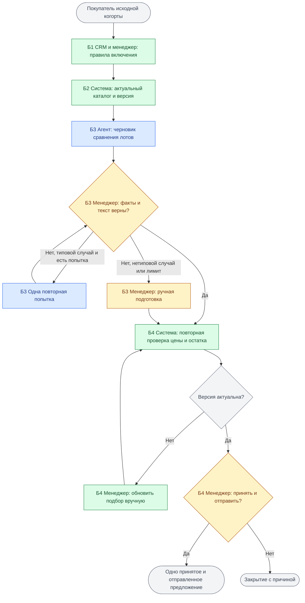
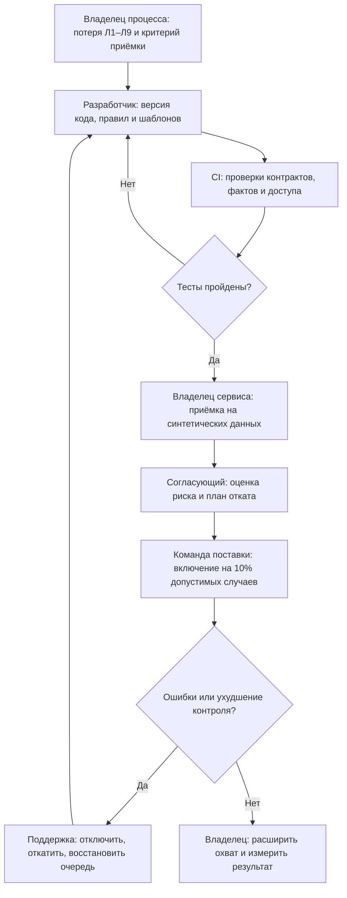

# Практическая работа №3 — Процессы под гипотезы

**Курс:** Управление информационными технологиями на предприятии  
**Семестр:** осень/зима 2026  
**Студент:** Мянчинская Ксения Олеговна  
**Дата:** 19.10.2026  
**Основание:** ПР2 «Гипотезы LEGENDA», редакция 18.10.2026, разделы 4–9 [И1].

## Краткая версия паспорта проекта — 5 строк

1. **Бизнес:** девелоперская группа LEGENDA; ООО «ЛЕГЕНДА» — управляющая организация; жилые и дополнительные объекты недвижимости в Санкт-Петербурге и Москве.
2. **Масштаб:** нормативная база — консолидированная выручка 2025 года **30,8 млрд ₽**; **1% = 308 млн ₽**; точная выручка МСФО — 30 756,106 млн ₽ [И1].
3. **Гипотезы в работе:** **Г1 — увеличение завершённых сделок**, **Г2 — дополнительные продажи паркингов и кладовых**; Г3–Г5 остаются в резерве.
4. **ИТ-функция:** предварительный диагноз ПР1 — «партнёр», зона 🟡; меняются процессы использования и интеграции действующих сервисов, без замены всей ИТ-системы.
5. **Доступ:** открытые источники и материалы проекта; внутренних журналов и наблюдений нет. Все времена, частоты возвратов и тарифные допущения ПР3 обозначены как модель и снабжены планом замера.

## 1. Выбор процессов и границы результата

Цель — перепроектировать два процесса, непосредственно обслуживающих принятые гипотезы. Финансовые параметры и отбор взяты из **исправленной**, а не первоначальной ПР2. Названия функциональных ролей отражают выполняемую работу; фактические должности, ФИО, системы и распределение ответственности подтверждаются на интервью. Наименование CRM и CI/CD-платформы не предполагается известным.

| Процесс | Связь с ПР2 | Начало → конец рассматриваемого участка | Принятый результат процесса | Финансовый результат, проверяемый отдельно |
|---|---|---|---|---|
| **П1. Подготовка и приёмка пакета оформления сделки** | Г1, §4.1 и §7.1: убрать потери на ручных переходах | Квалифицированная бронь передана в оформление → пакет принят для передачи клиенту либо дело закрыто с причиной | Один согласованный пакет по одной брони, с актуальными документами, условиями, ответственным и записью приёмки | Дополнительный действующий договор с предусмотренной оплатой; в эффект входит только дополнительная признанная выручка |
| **П2. Подготовка и отправка предложения дополнительного лота** | Г2, §4.2 и §7.1: адресное предложение исходной клиентской когорте | Существующий покупатель включён в допустимую кампанию → проверенное предложение отправлено либо подготовка прекращена | Одно проверенное предложение по одному клиентскому случаю, отправленное человеком в разрешённом канале | Дополнительная покупка лота в 90-дневном окне сверх контроля, после отмен, скидок и перетока между каналами |

Подписание, регистрация, оплата и бухгалтерское признание находятся **после границы локального перепроектирования**, но обязательно связываются с ним единым идентификатором в защищённой системе учёта. Принятый пакет и отправленное предложение не равны продаже. Десять черновиков одного предложения не образуют десять результатов.

П1 и П2 — два участка коммерческого пути, а поток поставки их цифровых изменений в §5 — обеспечивающий контур, не третья самостоятельная бизнес-гипотеза. Г5 о денежной экономии на документах не возвращается в работу автоматически: здесь труд измеряется для проверки стоимости П1, без добавления эффекта Г5.

## 2. Исходная точка: статус данных и план замера

### 2.1. Что является фактом, а что моделью

**Замер в компании не проведён.** Схемы AS-IS ниже — реконструкция для проверки с владельцами, не заявление о фактическом регламенте LEGENDA. Источники [И1; И2] подтверждают контекст и наличие цифровых возможностей, но не минуты на шагах. Все такие минуты — допущения **М1–М4**. В соответствии с условием задания для них указаны система, период, владелец и способ получения факта.

Таблицы задают расчётную исходную точку, поэтому арифметику можно воспроизвести. Они **не доказывают достигнутого улучшения**. До получения фактической базы допускаются проектирование и тест на синтетических примерах; экономическое решение о запуске и масштабировании переносится до сверки данных.

### 2.2. Протокол нулевого замера

| Что измеряем | Откуда и за какой период | Владелец данных / проверяющий | Как считаем и что должно получиться |
|---|---|---|---|
| Очереди и длительность шагов П1 | CRM, журнал документов, согласования; **01.07–30.09.2026**; дополнительно наблюдение **19.10–06.11.2026** | Руководитель оформления; бизнес-аналитик | Выгрузка событий по всем случаям периода, включая закрытые без результата; интервалы ожидания и работы по каждому шагу |
| Очереди, остатки и версии предложений П2 | CRM, каталог/реестр остатков, история цен и отправок; те же периоды | Руководитель продаж дополнительных лотов; CRM-аналитик | Связь случая с версией каталога, попытками и отправленным предложением; причины отмен и повторного подбора |
| Активная работа человека | Если её нет в логах — наблюдение/таймер за все рабочие дни **19.10–06.11.2026**, по всем участвующим сотрудникам пилотной группы | Владельцы процессов и аналитик | Регистрируются начало/пауза/конец работы и роль. Время нахождения карточки в статусе не принимается за время работы |
| Стоимость часа и переменность оплаты | Управленческий учёт, ФОТ с начислениями, счета подрядчиков; **2025 год** | Финансовый контролёр и HR | Полная стоимость функции / доступные рабочие часы; отдельно доля расходов, реально сокращаемая при высвобождении времени |
| Завершённые сделки Г1 и Г2 | Договоры, отмены, оплаты, признание выручки; **01.10.2025–30.09.2026**, только зрелые когорты | Коммерческий аналитик и финансы | Для Г1 окно 60 дней, для Г2 — 90 дней; незрелые когорты показываются отдельно, без искусственного занижения конверсии |
| Поток цифровых изменений | Git, CI/CD, журнал продуктивных релизов и инцидентов; **01.07–30.09.2026** | Ответственный за поставку изменений, свой или подрядный; владелец ИТ-сервиса | Таблица commit → deployment → incident → recovery по выбранному сервису, а не среднее по всей компании |

Если в периоде мало случаев, в отчёте указывают реальное n и расширяют ретроспективу; «100 случаев» в последующих расчётах — **нормировочная партия**, не размер реально собранной выборки. Ошибки и пропуски выгрузки не заполняются средними незаметно: доля неполных записей публикуется. Предлагаемый допуск к сравнению — не менее **95% случаев с полным набором обязательных временных отметок** [М8]. При меньшей полноте сначала исправляется регистрация событий.

Минимальные поля журнала: `case_id`, `process`, `step_id`, `attempt_id`, `role`, `ready_at`, `work_started_at`, интервалы пауз, `work_finished_at`, `result_status`, `reason_code`, `source_version`, `accepted_at`; для агента — номер попытки, версия модели/шаблона, длительность, стоимость вызова, решение проверяющего. Идентификаторы остаются в защищённом контуре; агент не получает таблицу связи с покупателями.

**Правила времени:** работа — сумма активных человеко-минут; ожидание — интервалы, когда результат готов к следующему действию, но никто над ним не работает, включая ожидание клиента и машинного ответа. В модели очереди считаются в **рабочих минутах единого предлагаемого календаря 09:00–18:00 по Москве, пн–пт, без праздников** [М1]. Поэтому ниже «часы цикла» — рабочие часы; реальные календарные часы от входа до выхода фиксируются отдельной метрикой. Ночь не исчезает из клиентского опыта. Машинный ответ включается в ожидание человека, но не объявляется устранимой организационной потерей.

Основные модельные шаги последовательны, поэтому средние времена складываются. Для реальных параллельных веток длительность цикла определяется по временным отметкам, а труд — суммой по исполнителям. Медианы и P90 отдельных шагов не суммируются. Возвраты имеют отдельные попытки; их время включается в итог, а не теряется при перезаписи статуса.

### 2.3. Нотация Mermaid

Используется равнозначная процессная нотация: скруглённые узлы — вход/выход, прямоугольники — действия с ролями, ромбы — условия, обратные стрелки — повторная работа. Это **не формальный BPMN-файл**. Коды узлов связывают схемы с таблицами времени и потерь.

В TO-BE **зелёные узлы — изменения**, **голубые — работа агента**, **жёлтые — обязательная человеческая приёмка**, серые — сохранённые действия/границы. Цвет дополняется кодами А/Б и текстом: связь не зависит от цветного отображения. Пунктирная стрелка показывает последующее измерение финансового результата за границей участка.

## 3. П1 — Пакет оформления сделки, гипотеза Г1

### 3.1. AS-IS: процесс до изменения

### 3.2. Таблица потерь AS-IS

Числа — модель М1. Источник фактического замера отсутствует; последний столбец указывает **план его получения**, а не уже сделанную выгрузку.

| Шаг / потеря | Роль | Работа, мин | Ожидание, мин | В чём потеря | Источник будущего замера |
|---|---|---:|---:|---|---|
| П1.1 / **Л1** | Менеджер продаж | 15 | 120 | Перенос реквизитов и очередь без единого ответственного | CRM: передача → назначение; таймер менеджера; владелец — продажи |
| П1.2 / **Л2** | Координатор оформления | 20 | 240 | Повторная сверка комплектности и неясный перечень недостающего | Версии комплектов и замечания; таймер координатора; владелец — оформление |
| П1.3 / **Л3** | Юрист | 30 | 480 | Пакетное согласование и ожидание в общей очереди | Журнал согласований: готовность → начало проверки; владелец — юридическая служба |
| П1.4 / **Л4** | Координатор оформления | 25 | 240 | Повторный ввод уже проверенных полей, сборка из разных версий | История шаблонов и правок, таймер; владелец — оформление |
| П1.5 / **Л5** | Руководитель оформления | 15 | 120 | Поиск актуальной версии и контекста для приёмки | Назначение задачи → начало приёмки → решение; владелец — оформление |
| П1.R, один возврат | Координатор и клиент | 12 | 480 | Повторный запрос и ожидание ответа клиента | Причина возврата, запрос/ответ, активные минуты координатора |

Основной маршрут: **105 минут работы + 1 200 минут ожидания**. Для модели предполагается один возврат у **25%** случаев; его вклад: 0,25×12 = 3 минуты работы и 0,25×480 = 120 минут ожидания. Строка возврата содержит весь дополнительный цикл, включая повторную сверку: шаг П1.2 второй раз отдельно не прибавляется.

**AS-IS на один входящий случай: 108 минут работы + 1 320 минут ожидания = 1 428 минут, или 23,80 рабочего часа.** Ожидание занимает **92,44%** цикла. Это основание менять очереди и передачу контекста, а не только ускорять набор текста. Предположенная частота возврата ограничена одним циклом лишь для расчёта; при замере учитываются все фактические возвраты.

### 3.3. TO-BE: процесс после изменения

Агент не проверяет паспорта и не принимает юридическое решение. Проверка наличия файлов и обязательных полей выполняется обычными правилами в защищённой системе. Агент по разрешённым кодам недостатков и утверждённому регламенту предлагает понятный текст перечня; координатор проверяет его до использования. Узел А2 включает приёмку **каждой** попытки, а не выборочную проверку. После ответа клиента недостающие документы сверяют сотрудник и правила системы; агент заново не вызывается, поэтому цикл уточнения не добавляет скрытых генераций.

| Изменение | Какую потерю убирает; связь с Г1 | Ответственный | Работа после, мин/случай | Ожидание после, мин/случай |
|---|---|---|---:|---:|
| **А1** | Л1: единое дело, обязательные поля, назначение владельца; меньше потерь при передаче брони | Менеджер + системный маршрут | 5 | 15 |
| **А2** | Л2: единый проверенный перечень, понятный клиенту; меньше последовательных запросов | Агент + координатор, принимающий результат | **8,2**, включая все проверки и ручной резерв (§6.3) | **32,3**: очередь 30 + 1,15 вызова×2 минуты |
| **А3** | Л3: адресная очередь и эскалация ожидания; юридическая проверка сохраняет глубину | Юрист; координатор при уточнении | 30 | 240 |
| **А4** | Л4: автоматическая сборка из утверждённых полей без повторного ввода | Детерминированная система + координатор | 8 | 30 |
| **А5** | Л5: одна версия, чек-лист и история изменений для финальной приёмки | Руководитель оформления | 12 | 30 |
| Возврат после изменений | Единый запрос вместо цепочки; модель **10% × один цикл** | Координатор, юрист и клиент | 0,10×8 = **0,8** | 0,10×240 = **24** |
| **Итого** | Все изменения обслуживают Г1 | Владелец — руководитель оформления | **64,0** | **371,3** |

Полный цикл TO-BE: **435,3 минуты = 7,255 рабочего часа**; сокращение к модели базы **69,52%**. Работа уменьшается на 44 минуты (40,74%). Сокращение цикла не означает такого же прироста выручки. Желаемые значения ожидания — цели организации очередей, а не гарантированный эффект установки агента. Повторная юридическая сверка после уточнения входит в дополнительные 8 минут цикла возврата; если фактически нужна полная повторная проверка, модель пересчитывается.

## 4. П2 — Предложение дополнительного лота, гипотеза Г2

### 4.1. AS-IS: процесс до изменения

### 4.2. Таблица потерь AS-IS

Все числа — модель М2; фактический замер планируется по §2.2.

| Шаг / потеря | Роль | Работа, мин | Ожидание, мин | В чём потеря | Источник будущего замера |
|---|---|---:|---:|---|---|
| П2.1 / **Л6** | Менеджер дополнительных лотов | 12 | 240 | Ручное выделение исходной когорты и проверка доступного канала контакта | CRM, правила кампании; таймер; владелец — коммерческий руководитель |
| П2.2 / **Л7** | Менеджер и специалист каталога | 18 | 480 | Ожидание подтверждения доступности/цены; несогласованные версии | История остатков, запросы к специалисту; владелец — каталог |
| П2.3 / **Л8** | Менеджер | 20 | 240 | Повторная сборка текста и сравнения свойств лотов | Версии предложений и таймер; владелец — продажи дополнительных лотов |
| П2.4 / **Л9** | Менеджер | 10 | 120 | Поздняя проверка доступности; повторная подготовка уже готового текста | Версия цены на момент отправки и журнал отправок; владелец — продажи |
| П2.R, один повторный подбор | Менеджер | 10 | 240 | Переделка после изменения наличия/цены | Причина пересборки, версии и активные минуты |

Основной маршрут: 60 минут работы и 1 080 минут ожидания. При одном повторе у **20%** случаев добавляются 2 минуты работы и 48 минут ожидания. Строка повтора включает весь дополнительный подбор и исправление; основные шаги второй раз не прибавляются.

**AS-IS: 62 + 1 128 = 1 190 минут = 19,833 рабочего часа на случай.** Ожидание занимает **94,79%** цикла.

### 4.3. TO-BE: процесс после изменения

При новом подборе Б4 менеджер вручную обновляет текст по свежему каталогу, затем система повторно проверяет данные. Дополнительного вызова агента в этом цикле нет. Лимит двух генераций ведётся **на весь клиентский случай**; 20 повторных вызовов на 100 случаев в §6.3 относятся только к исправлениям черновика Б3. Работа с изменившимся каталогом и повторная человеческая проверка включены в строку возврата.

| Изменение | Какую потерю убирает; связь с Г2 | Ответственный | Работа после, мин/случай | Ожидание после, мин/случай |
|---|---|---|---:|---:|
| **Б1** | Л6: правила выделяют допустимых клиентов; новые покупатели Г1 исключены | CRM и менеджер | 4 | 15 |
| **Б2** | Л7: доступен версионированный каталог, нет отдельного ручного запроса на каждый подбор | Владелец каталога и интеграция | 4 | 15 |
| **Б3** | Л8: черновик по утверждённым сведениям, затем проверка человеком | Агент и принимающий менеджер | **6,2**, включая повторы и ручную подготовку (§6.3) | **32,4**: очередь 30 + 1,2 вызова×2 минуты |
| **Б4** | Л9: повторная проверка данных непосредственно перед отправкой; запрет устаревшего предложения | Система и менеджер | 6 | 15 |
| Повторный подбор | Модель: **5% × один цикл**, все дополнительные проверки включены | Менеджер | 0,05×6 = **0,3** | 0,05×60 = **3** |
| **Итого** | Все изменения обслуживают Г2 | Владелец — руководитель продаж дополнительных лотов | **20,5** | **80,4** |

**TO-BE: 100,9 минуты = 1,682 рабочего часа**; сокращение цикла **91,52%**. Столь сильное модельное снижение объясняется исходными очередями, но без замера не является результатом компании. Объём проданных лотов из этого процента не выводится. Система проверяет доступность перед отправкой; резервирование и изменение цены выполняются только уполномоченным сотрудником по действующему регламенту.
## 5. Практики ITIL 4 и поток поставки DevOps

### 5.1. Только практики, которые действительно меняются

Названия и назначение практик сверены с PeopleCert [И3–И6]. Численные обещания ниже — предлагаемые условия пилота **М8**, а не предписания ITIL и не действующие SLA LEGENDA.

| Практика ITIL 4 | Почему затронута | Конкретное изменение в П1/П2 | Ответственный, артефакт и контроль |
|---|---|---|---|
| **Service level management** | А1–А5 и Б1–Б4 меняют ожидание внутреннего заказчика и готовность ответа клиенту | Фиксируются начало/конец услуги, сервисный календарь, ожидание клиента и отдельный календарный срок. Цели среднего рабочего цикла: П1 ≤8 ч, П2 ≤2 ч; P90: П1 ≤24 ч, П2 ≤8 ч. P90 измеряется отдельно от среднего | Владельцы оформления/продаж и ИТ: паспорт услуги, согласованные цели, еженедельный отчёт с n, средним, P90, отказами и внешним ожиданием. Обещание не считается согласованным до их подтверждения |
| **Change enablement** | Ошибка в правилах, интеграции или шаблоне может массово остановить оформление либо исказить предложение | Изменения А2/А4/Б2/Б3/Б4 версионируются; владелец проверяет риск и возможность отката. Неизменяемые низкорисковые шаблоны могут перейти в заранее одобренный стандартный маршрут после пилота. Цены, права и юридические условия всегда проходят отдельное уполномоченное согласование | Владелец цифрового сервиса и назначенный согласующий изменения: запись изменения, результаты тестов, версия, план отката, решение о выпуске |
| **Monitoring and event management** | Ручная очередь и устаревший каталог могут быть замечены слишком поздно — потери Л1/Л3/Л7/Л9 | События: превышение очереди, недоступность интеграции, несоответствие версии, повторная ошибка агента. Проверка свежести каталога: порог 15 мин; перед отправкой обязательна повторная проверка текущей цены и наличия. Просроченные данные блокируют отправку | Дежурный поддержки: журнал событий, задача владельцу, метрика задержки обнаружения. Сигнал о сбое — не позднее 5 мин; обработка событий отделена от всех обычных клиентских операций |
| **Incident management** | Новый процесс зависит от цифровых компонентов; без восстановления потеря скорости переходит в потерю сделок | При недоступности агента — ручная подготовка; при недоступности каталога — ручное подтверждение владельцем каталога либо приостановка предложения. Ошибочный выпуск отключается флагом/откатом, случаи восстанавливаются по журналу без повторной отправки | Руководитель поддержки: карточка инцидента, связь с релизом и затронутыми случаями, ответственный, восстановление и проверка очереди. Цель начала ручного режима — ≤30 мин от обнаружения |

**Service request management** отдельно не включена: покупка недвижимости не объявляется ИТ-запросом на обслуживание, а изменения каталога стандартных ИТ-запросов здесь не проектируются. **Problem management** и **Supplier management** также не перечисляются формально: отдельные новые процессы анализа причин и управления поставщиками в объём ПР3 не включены. Повторяющиеся инциденты фиксируются и передаются действующим владельцам для дальнейшего решения.

### 5.2. Почему DORA здесь применима

Реализация интеграций, правил маршрутизации и проверок создаёт поток версионируемых цифровых изменений. Наличие у LEGENDA собственной разработки именно этого контура и конкретного инструментария не установлено. Поэтому ниже дан **условный вариант DORA для выделенного сервиса оформления/предложений при наличии собственной разработки**. Отсутствие сведений не объявляется доказательством её отсутствия. Если обследование подтвердит, что собственной разработки нет, пункт по условию задания пропускается с формулировкой: «Собственной разработки нет; DORA к данному бизнесу в ПР3 не применяется». Контроль поставки и приёмки внешних изменений и метрики бизнес-процесса при этом сохраняются.

По заданию приводятся **четыре классических показателя DORA** [И7]. В текущем руководстве DORA модель уже содержит пять показателей, а восстановление уточнено применительно к неудачному развёртыванию [И8]. Здесь сохраняется состав задания; для восстановления явно выделяются инциденты после релизов. Метрики не измеряют производительность отдельных разработчиков и не заменяют результат клиента.

### 5.3. База и цели четырёх показателей

**Фактических данных нет.** Таблица М7 — исходный сценарий для проектирования, не оценка зрелости LEGENDA. Цели — к T₀ + 3 месяца; восстановление обычных, не связанных с релизом сбоев отслеживается отдельно.

| Показатель | Модельная база до изменения | Цель пилота | Как получить фактическую базу и проверить |
|---|---|---|---|
| **Deployment frequency — частота выкаток** | 6 продуктивных выпусков за июль–сентябрь: **2/месяц** | **4/месяц**, только полезные изменения | Успешные продуктивные deployment ID за период; CI/CD и журнал релизов. Повторный запуск того же задания без нового выпуска не считается |
| **Lead time for changes — commit → production** | Медиана **10 календарных дней** по изменениям этих выпусков | Медиана **≤2 календарных дней** | Commit time → первый успешный production deployment с этим commit. Полный список наблюдений и P90, не время от постановки бизнес-задачи |
| **Change failure rate — доля неудачных изменений** | **1/6 = 16,7%** выпусков вызвал инцидент, требующий вмешательства | **≤10%** за квартал, вместе с числителем/знаменателем | Связь deployment → инцидент/откат/hotfix; не доля упавших тестов. При 12 выпусках один сбой — 8,3%, два — 16,7%; малую выборку нельзя трактовать как устойчивую статистику |
| **Время восстановления после неудачного выпуска** | **8 календарных часов**, одно модельное событие | Медиана **≤1 часа** по реальным событиям | От начала воздействия сбоя, связанного с выпуском, до подтверждённого восстановления сервиса; инциденты и мониторинг. При отсутствии событий — «нет наблюдений», не 0; учебный откат учитывается отдельно |

До T₀ ответственный за поставку выгружает реальные релизы и инциденты за 01.07–30.09.2026. Если один инцидент недостаточен для выводов, показываются все события за более длинный период с датами. Ускорение выпусков не оправдывает ухудшение ошибок и восстановления.

### 5.4. Новый поток поставки изменений

Это изменение обслуживает обе гипотезы: маленький выпуск и обратимый флаг уменьшают риск массовой потери случаев при исправлении Л1–Л9. В контрольный набор входят отсутствующие документы, противоречащие правила, устаревшая цена, занятый лот, двойной запрос, недоступность агента и попытка подменить инструкцию текстом входных данных. Валидируются ссылки на источники, а не только форма JSON. Изменение модели или промпта проходит тот же маршрут, что изменение кода.

Начальный технический охват **10%** — краткий этап безопасного включения [М8], не среднегодовой коэффициент 80% из ПР2. После него распространение планируется помесячно. Если фактический среднегодовой охват ниже 80%, финансовый эффект пересчитывается. Отдельный тест агента при неизменной маршрутизации нужен, чтобы отличить пользу генерации текста от пользы обычной автоматизации очередей.

## 6. Место агента: четыре обязательных вопроса

### 6.1. Какие шаги могут уйти агенту

| Участок | Проверяемое задание агенту | Что остаётся обычной автоматизацией |
|---|---|---|
| **А2, П1** | Составить черновик понятного перечня недостающих элементов по разрешённым кодам и утверждённой версии регламента; для каждого пункта дать основание | Проверка заполненности полей, наличия файлов, обязательных реквизитов и маршрута; заполнение документов персональными сведениями |
| **Б3, П2** | Составить черновик сравнения доступных лотов и текст предложения по утверждённому каталогу; свойства и ограничения снабдить ссылками на запись/версию | Отбор допустимой когорты, проверка контакта, актуальная цена, наличие, резервирование и проведение сделки |

Генерация разрешена там, где проверяющий может сверить текст с конечным набором исходных фактов. Агент не ищет самостоятельно новые условия продажи и не обещает доходность, скидку или доступность лота без подтверждения системы.

### 6.2. Что агент видит, чем действует и где граница

**Разрешённые входы:** утверждённые неперсональные регламенты и шаблоны; общие коды недостающих элементов; характеристики, цены и версии разрешённого каталога без связи с покупателем. Задание формируется защищённым приложением: из него удаляются ФИО, телефоны, адреса клиентов, номера договоров, паспортные данные, документы, платёжные сведения и свободный текст переписки. Контекст, из которого личность можно восстановить косвенно, также исключается; достаточность такого отделения проверяет ИБ до допуска.

**Разрешённые действия:** чтение ограниченного справочника, создание версии черновика в отдельной области, возврат структурированного результата с источниками. Связь результата с клиентским делом устанавливает защищённое приложение, а не модель. Нет доступа ко всей CRM, таблице идентификаторов, почте, файловому хранилищу документов или произвольным внешним адресам.

**Запрещённые права:** отправка сообщения клиенту, изменение цены/остатка, создание брони, подписание договора, одобрение проверки, изменение ролей и выпуск в production. Автоматическая запись возможна только в поле «черновик», которое не является принятым результатом. Агент использует отдельную техническую учётную запись с минимальными правами; вызовы и версии регистрируются без секретов и исходных персональных документов.

Входные тексты рассматриваются как данные, а не инструкции на расширение прав. При отсутствии источника, конфликте версий или недоступности сервиса результат передаётся человеку. Лимит — **два вызова на случай: первый и один повтор** [М3]. Сведения, необходимые для правового решения или идентификации покупателя, обрабатывает уполномоченный сотрудник вне агентного контура.

### 6.3. Кто принимает результат и сколько стоит приёмка

**П1:** координатор сверяет перечень с регламентом и кодами недостатков: полнота, отсутствие лишних требований, корректные основания, отсутствие ПД. Юрист затем проверяет реальные документы и условия; руководитель оформления принимает итоговый пакет.

**П2:** менеджер проверяет свойства и цену по источнику, отсутствие придуманных обещаний, корректность сравнений и допустимость контакта в CRM; непосредственно перед отправкой система повторно проверяет цену/остаток. Отправляет только человек. При несовпадении цена не «исправляется по догадке» агента.

Ниже — **нормировочная партия 100 входящих случаев**, а не результаты испытания [М3]. Все попытки оплачиваются и проверяются. В каждом процессе 5 случаев требуют ручной подготовки после неприемлемого первого ответа; в остальных повтор выполняется только один раз.

| Показатель | А2 — перечень документов | Б3 — черновик предложения |
|---|---:|---:|
| Принято с первого вызова | 80 | 75 |
| Принято со второго вызова | 15 | 20 |
| Сразу передано в ручную подготовку после первой проверки | 5 | 5 |
| Все вызовы, включая непринятые | **100 + 15 = 115** | **100 + 20 = 120** |
| Человеческая проверка каждого вызова | 115×6 = **690 мин** | 120×4 = **480 мин** |
| Формулировка замечаний для повторов | 15×2 = **30 мин** | 20×2 = **40 мин** |
| Полная ручная подготовка при отказе от агента | 5×20 = **100 мин** | 5×20 = **100 мин** |
| **Весь человеческий труд узла / 100 случаев** | **820 мин / 100 = 8,2 мин** | **620 мин / 100 = 6,2 мин** |

В этих центральных сценариях вторые попытки успешны. Если повтор также не принят, работа уходит человеку; **в его стоимость добавляются вторая проверка и ручная подготовка**, а не исключается случай из отчёта. При полном отказе сервиса используется ручная процедура; её фактический объём входит в расходы.

Для оценки стоимости приняты параметры М4–М5:

- **s = 1 200 ₽/час = 20 ₽/мин** — единая нормировочная полная стоимость труда бизнес-ролей в ценах 2025 года, эквивалент 192 000 ₽ за 160 часов. Это не зарплата LEGENDA, не вакансия и не рыночная котировка; финансы заменяют её фактом. Чувствительность — 600–1 800 ₽/час. Для реальных разных ставок используется сумма времени каждой роли × её ставка.
- **g = 20 ₽ за вызов** — верхний расчётный лимит переменных затрат агента, а не прайс конкретной модели. Каждый вызов включает разрешённые операции генерации/поиска; дополнительные платные операции добавляются отдельно. Требуется фактическая смета поставщика с приведением к ценам базы. Время одного вызова — модельные 2 минуты.

Стоимость собственно проверок и замечаний на 100 входов: П1 **(690+30)×20 = 14 400 ₽**, П2 **(480+40)×20 = 10 400 ₽**. Вместе с ручной подготовкой: соответственно **16 400 ₽** и **12 400 ₽**. Финальная приёмка А5/Б4 включена отдельно в таблицы процессов — она не теряется в этих суммах.

### 6.4. Что не отдаётся агенту и почему

| Шаг | Кто выполняет | Почему оставлен человеку / проверяемой системе |
|---|---|---|
| Проверка паспорта, полномочий, договора и правовых оснований | Юрист и уполномоченный координатор | Персональные данные и правовые последствия; убедительный текст не гарантирует правильного решения |
| Цена, скидка, бронь и доступность | Уполномоченный менеджер и транзакционная система | Денежное обязательство и конкурентные изменения остатка; нужен авторитетный источник и контроль версии |
| Финальная приёмка и отправка | Руководитель оформления / менеджер | Ошибка выходит за внутренний черновик и затрагивает клиента; нужна персональная ответственность |
| Отказ клиенту, нетиповой случай или противоречие регламентов | Владелец процесса с юристом | Ошибка может обнаружиться только после сделки; нельзя автоматически заменить рассмотрение генерацией |
| Подписание, платёж и признание выручки | Клиент, уполномоченные сотрудники, банк, финансы | Юридически и финансово значимые действия за границей полномочий агента |

## 7. Эффект на принятый результат и сопоставление с ПР2

### 7.1. Знаменатель и стоимость полного процесса

Нормировочная партия содержит **100 начатых случаев**. Для консервативного сравнения доля конечного принятого результата фиксирована одинаковой до и после: **95 принятых пакетов П1** и **90 принятых и отправленных предложений П2** [М6]. Оставшиеся 5 и 10 случаев закрываются без результата; **затраты на них остаются в числителе**. В модели им начислен весь труд маршрута — осторожное допущение; фактически берутся все потраченные минуты, включая незавершённую работу и ошибки.

Число принятых агентных черновиков из §6.3 и число финально принятых пакетов/предложений — разные показатели. Ручной резерв сначала завершает работу узла, но не гарантирует, что клиентский случай даст финальный результат. Возвраты клиента, повторный подбор и дополнительная приёмка уже включены в средние трудозатраты таблиц.

**Удельная стоимость = (весь труд всех начатых случаев × ставка + все переменные вызовы) / число финально принятых результатов.** Если результатов нет, удельная стоимость не определена; все затраты остаются расходом, а не обнуляются.

| Метрика на 100 начатых случаев | П1: до | П1: после | П2: до | П2: после |
|---|---:|---:|---:|---:|
| Финально принято | 95 | 95 | 90 | 90 |
| Все человеко-минуты | 10 800 | 6 400 | 6 200 | 2 050 |
| Стоимость труда при s = 20 ₽/мин | 216 000 ₽ | 128 000 ₽ | 124 000 ₽ | 41 000 ₽ |
| Все вызовы агента | 0 | 115 | 0 | 120 |
| Переменная стоимость агента | 0 ₽ | 2 300 ₽ | 0 ₽ | 2 400 ₽ |
| **Стоимость на один принятый результат** | **2 273,68 ₽** | **1 371,58 ₽** | **1 377,78 ₽** | **482,22 ₽** |
| Труд на принятый результат | 113,68 мин | 67,37 мин | 68,89 мин | 22,78 мин |

Расчёт П1 после: (128 000 + 2 300) / 95 = **1 371,58 ₽**. Расчёт П2 после: (41 000 + 2 400) / 90 = **482,22 ₽**. Разница — **902,11 ₽** и **895,56 ₽ на принятый результат**. Это снижение расчётной операционной стоимости, **без распределения разового внедрения**. Оно не называется чистой прибылью; K учитывается в годовом расчёте §7.3.

Весь узел агента с проверкой, замечаниями и ручным резервом стоит на финально принятый результат: П1 (16 400+2 300)/95 = **196,84 ₽**, П2 (12 400+2 400)/90 = **164,44 ₽**. Таким образом, стоимость принятия работы не скрыта за низкой ценой генерации.

Средний рабочий цикл для сопоставимой завершённой траектории: П1 **23,80 → 7,255 ч**, П2 **19,833 → 1,682 ч**. Время цикла не делится на коэффициент приёмки: это отдельная метрика по временным отметкам. Для отказов и незавершённых случаев публикуются возраст очереди и причины; быстрые успешные случаи не должны скрывать накопление сложных.

### 7.2. Высвобождение мощности не равно экономии P&L

При охвате ПР2 **2 135×80% = 1 708 случаев П1** и **1 000×80% = 800 случаев П2** за первый год модель даёт:

- П1: 1 708×(108−64)/60 = **1 252,53 часа**;
- П2: 800×(62−20,5)/60 = **553,33 часа**;
- всего **1 805,87 человеко-часа**.

Это **резерв мощности**, пока не сокращены оплаченные сверхурочные, подрядный объём или подтверждённый найм. В финансовый эффект ПР3 дополнительная денежная экономия труда принята равной **нулю**. Тем самым не включается резервная Г5 и не удваивается эффект Г1/Г2. Эти часы также не добавляются автоматически к общей мощности оформления 80 дополнительных договорных пакетов из ПР2: там другое узкое место и требуется отдельная проверка ролей, нагрузки и календаря.

### 7.3. Связь процесса с выручкой и полная стоимость первого года

В ПР2 приняты **условные**, ещё не проверенные параметры: N₁ = 2 135, прирост конверсии Δc = 1 п.п., чек 20 млн ₽, охват 80%, признание 50%; N₂ = 1 000, прирост покупки Δb = 10 п.п., чек 2 млн ₽, охват 80%, признание 70% [И1]. В ПР3 эти параметры не повышаются из-за сокращения очередей.

| Гипотеза | Сохраняемый расчёт ПР2, млн ₽ | Коридор одного улучшения на выручку |
|---|---:|---|
| Г1 | 2 135×0,01×20×0,80×0,50 = **170,800**; **0,555% R₀** | Внутри **0,2–1%**, если прирост и признание подтвердятся |
| Г2 | 1 000×0,10×2×0,80×0,70 = **112,000**; **0,364% R₀** | Внутри **0,2–1%**, если покупки дополнительны к контролю |

Это эффект **дополнительных принятых сделок**, а не количества черновиков или ускоренных пакетов. Для Г1 фиксируются оплаченные действующие договоры и отмены; для Г2 — покупки по всем каналам, а не только по отправленному предложению. Дополнительные клиенты Г1 исключаются из самостоятельной базы Г2.

При сохранении общего ограничения ПР2 **80 / (17,08 + 80) = 0,8240626** совместная дополнительная выручка равна **233,044911 млн ₽**. Само ускорение П1/П2 не снимает это ограничение без замера downstream-оформления. Коридор «набор из пяти» к двум процессам не применяется. Проценты сокращения времени также не сравниваются с коридором экономии статьи: это разные показатели.

Стоимость первого года из ПР2: **K₁ = 13,824 млн ₽, K₂ = 8,064 млн ₽**, включая подготовку, масштабирование, поддержку и резерв; общий m = **22,8332424%**. В ПР2 новые платные вызовы были условно нулевыми. Теперь переменные расходы агента добавляются явно:

- П1: 1 708×1,15×20 = **39 284 ₽**, или **0,039284 млн ₽**;
- П2: 800×1,20×20 = **19 200 ₽**, или **0,019200 млн ₽**;
- всего **0,058484 млн ₽**, поэтому **K пары = 21,946484 млн ₽**.

**Условный чистый вклад первого года = 233,044911×0,2283324244 − 21,946484 = 31,265226 млн ₽.** Это сценарный вклад до иных неучтённых налоговых/финансовых последствий, не подтверждённая прибыль компании. Принятые операционные результаты уже учтены в затратах времени; их стоимость второй раз к K и выручке не прибавляется.

Для интеграции агента предварительно резервируются **80 часов реализации на каждый процесс** внутри существующих пакетов разработки ПР2 и **1 час администрирования в месяц на процесс** внутри годовой поддержки [М9]. Проверка черновиков — бизнес-труд из §7.1; тестирование решения — отдельный проектный труд внутри K. Если архитектор и смета не подтвердят достаточность этих часов, нужны дополнительные K. Новые лицензии, защищённое размещение, аудит или обучение не признаются бесплатными: они добавляются по фактической смете. Пока сметы нет, 31,265 млн ₽ — условная оценка с этим ограничением.

### 7.4. Когда гипотеза не подтверждается

- **Г1:** пакет готов быстрее и цифровая доля растёт, но конверсия в оплаченный договор относительно контроля не выросла либо дополнительная выручка не признана в годовом окне. Тогда подтверждено улучшение участка, но не финансовая гипотеза.
- **Г2:** предложений отправлено больше, но общие продажи лотов не выросли или прирост получен скидкой, поглощающей вклад. Тогда дополнительной выручки требуемого качества нет.
- **Агент:** если обычный шаблон и правила без генерации дают тот же принятый результат дешевле, агент исключается; гипотезу Г1/Г2 можно продолжать проверять без него. Нельзя приписывать ему всю пользу новых очередей.
- **Приёмка:** при s = 20 ₽/мин и прочих неизменных параметрах средняя трудоёмкость узла А2 должна быть **менее 18,85 мин/случай**, чтобы сам этот узел стоил дешевле прежних 20 минут: 20−23/20. Для Б3 аналогичный предел — **18,8 мин**: 20−24/20. Эти пределы включают все проверки, замечания и ручную подготовку. Разовые затраты дополнительно проверяются через K.
- **Надёжность результата:** если финальная приёмка падает ниже исходных 95%/90%, сравнение пересчитывается с фактическим знаменателем; падение качества не маскируется ростом числа черновиков. При нулевом подтверждённом приросте выручки и отсутствии денежной экономии затраты инициативы остаются, а финансовый результат отрицателен.

## 8. Trade-off: что ухудшается

**Скорость против нагрузки на контроль.** У координатора и менеджера появляется регулярная проверка агентного текста: в модели 720 и 520 минут на 100 случаев только на проверки и замечания, ещё до ручного резерва и финальной приёмки. Проверка проходит чаще, требует внимания к фактам и создаёт риск привычного одобрения. Поэтому сокращение собственно подготовки не позволяет убрать принимающую роль. Если её очередь растёт, заявленные времена TO-BE не достигаются.

**Автоматизация против устойчивости.** Появляются дополнительные зависимости от агента, интеграции и свежести каталога. Устаревшие данные теперь блокируют отправку, поэтому при сбое отдельный клиент получит предложение позже. Это сознательный компромисс ради корректной цены и доступности. Требуются ручной маршрут, журнал и ресурсы поддержки; их стоимость включается в проверку экономики.

**Стандартизация против гибкости.** Нетиповые договоры и предложения после одной неудачной повторной попытки идут человеку. Для них процесс может стать медленнее исходного: добавились генерация и проверка. Такие случаи показываются отдельной группой с собственным временем, а не исключаются из отчёта как «неудобные».

**Минимизация данных против качества персонализации.** Агент не видит документы и переписку покупателя, поэтому его текст может быть менее точным по индивидуальному контексту. Уточнение делает сотрудник. Расширять доступ к ПД ради уменьшения нескольких минут приёмки в этом решении не предлагается.
## 9. Порядок проверки и решение по пилоту

### 9.1. До изменения

**19.10–06.11.2026:** владельцы уточняют AS-IS на интервью, выгружают историю и проводят хронометраж по §2.2. Аналитик связывает попытки, отказы и принятые результаты; финансы заменяют нормировочную ставку и уточняют оплачиваемость высвобождённых часов. Архитектор проверяет смету и доступность интеграций. До начала пилота сохраняются версия схемы, исходная таблица показателей, определения знаменателей и причины исключений. Если базу восстановить нельзя, устанавливается журнал и сначала накапливаются наблюдения; старт переносится.

### 9.2. После изменения

**T₀ = 09.11.2026** — предложенная дата, действующая только после получения базы и допуска владельцев. Начало — синтетическая проверка, затем ограниченное включение на 10% допустимых случаев. Каждую неделю анализируются полный цикл, работа/ожидание, число всех попыток, стоимость, финальная приёмка, ошибки после приёмки, закрытия без результата и возраст незавершённых дел. Сравнение проводится по одинаковым классам сделок/лотов, периодам и стадиям готовности.

Предлагаемые критерии расширения охвата [М8]:

- средний рабочий цикл П1 ≤8 ч, П2 ≤2 ч; P90 измерен и укладывается в согласованные границы §5.1;
- финальная доля принятия не ниже фактической исходной; в модели — 95%/90%; доля ошибок после принятия не выросла относительно контроля;
- нет выявленных отправок с недопустимой ценой, отсутствующим лотом, неразрешённым обещанием или попадания ПД в агентный контур; любое такое событие — остановка автоматизированного участка и разбор;
- все вызовы, проверки и ручные обходы учтены; цена принятого результата ниже базы; режим восстановления проверен;
- бюджет K и переменные тарифы подтверждены, у принимающих сотрудников есть время на обязательную проверку.

Ноль обнаруженных критических ошибок на малой выборке не доказывает нулевой риск. Помимо доли ошибок указываются абсолютные числа, объём и способ контроля. Порог по качеству фиксируется до начала сравнения, а не подбирается под полученный результат.

**T₀ + 3 месяца:** оценка потока поставки и устойчивости. **T₀ + 6 месяцев, 09.05.2027:** промежуточное решение по Г1/Г2 на зрелых когортах. **08.11.2027:** закрытие годового окна, сверка признанной выручки и полной стоимости. У Г1 поток около 2 135 броней в год недостаточен для надёжного доказательства прироста всего 1 п.п. в коротком пилоте при стандартных требованиях статистической мощности; ограничение уже рассчитано в ПР2 §5.7. Поэтому операционный успех не объявляется статистически доказанным финансовым эффектом.

### 9.3. Связь с долгами ПР2

Цифровая доля **38% → 61% через шесть месяцев → ≥70% через 24 месяца** остаётся программной целью из ПР2. П1 влияет на передачу/согласование документов, П2 — на цифровое предложение в начале пути. Цель 61% по всему пути не считается выполненной только по результатам этих двух участков: отдельно нужны данные подписания, финансирования и передачи квартиры. Внутренний черновик агента не является цифровым взаимодействием покупателя; считается завершённая клиентская операция по методике ПР2 §5.8.

Подготовленный в ПР2 перечень данных для СП не расширяет доступ агента и не означает согласованной передачи. В ПР3 данные покупателей партнёру не передаются; фактическое согласование Д-2 остаётся отдельным условием.

## 10. Реестр допущений ПР3

| Код | Что принято в модели | Основание, статус и критичность | Кто и чем проверит |
|---|---|---|---|
| **М1** | П1: все времена §3, 25% возвратов до/10% после, один цикл; календарь 09–18 пн–пт | Декомпозиция предполагаемой работы и проектные цели очередей; **не внутренний замер**. Критическая | Руководитель оформления, юрист и аналитик: интервью, CRM/документы, таймеры, полный журнал попыток, до T₀ |
| **М2** | П2: все времена §4, 20% повторного подбора до/5% после | Реконструкция операции и целевой порядок работы с каталогом; **не статистика LEGENDA**. Критическая | Продажи дополнительных лотов и владелец каталога: версии, запросы, отправки, таймеры, до T₀ |
| **М3** | П1: 80/15/5; П2: 75/20/5; проверка 6/4 мин, замечания 2 мин, ручной резерв 20 мин; вызов 2 мин | Сценарии приёмки для расчёта всех затрат, а не качество конкретной модели. Критическая | Принимающие сотрудники: размеченная проверочная выборка и теневой пилот; журнал всех вызовов/замечаний/решений. Непринятые повторные попытки добавляются в ручной резерв |
| **М4** | Бизнес-труд 1 200 ₽/ч; 160 ч/месяц; чувствительность 600–1 800 ₽/ч | Нормировка 192 000/160; не прайс и не зарплата компании. Критическая для удельной стоимости, не для расчёта дополнительной выручки | Контролёр/HR: реальные полные ставки по ролям в ценах 2025 года, часы и изменяемая часть оплаты, до экономического решения |
| **М5** | Переменный агентный запуск ≤20 ₽, включая оплачиваемые операции; не более двух запусков на случай | Проектный лимит бюджета, не предложение поставщика. При цене выше лимита нужна новая смета. Высокая | Закупки/ИТ/финансы: тариф, токены, вызовы инструментов, налоги и правила хранения; фактический биллинг на все попытки |
| **М6** | 100 входов дают 95 принятых пакетов / 90 предложений; одинаково до и после; закрытиям начислен полный труд | Консервативная нормировочная партия для сопоставимости; не экспериментальная выборка. Критическая | Аналитик: все начатые случаи, статусы приёмки, отказов и незавершённости, труд по каждой попытке; реальный знаменатель в пилоте |
| **М7** | DORA: 6 релизов/квартал, медиана 10 дней, один неудачный релиз, восстановление 8 ч; цели §5.3 | Условный вариант для выделенного контура собственной разработки; существование контура ещё проверяется. Высокая | ИТ-руководитель: подтвердить применимость; команда поставки: связка Git/CI/CD/инцидентов. При отсутствии собственной разработки раздел помечается неприменимым |
| **М8** | Полнота данных ≥95%; цели среднего/P90; свежесть 15 мин; обнаружение 5 мин; ручной режим 30 мин; начало с 10% случаев; сроки §9 | Предложенные условия пилота, а не норматив ITIL или действующий SLA. Высокая | Владельцы процессов/ИТ: подписанный план замера, паспорт услуги, контрольная выборка, нагрузочная проверка очереди и протокол восстановления |
| **М9** | По 80 ч интеграции агента и 1 ч администрирования в месяц внутри K; дополнительная инфраструктура требует проверки | Предложенное распределение часов существующей сметы ПР2, не гарантированная бесплатная ёмкость. Критическая | Архитектор/руководитель проекта: WBS, ресурсный календарь, лицензии, стоимость защищённого размещения и смета до запуска |
| **М10** | N, Δc/Δb, a, q, m, K и общая мощность 80 пакетов | Перенос **условных параметров** исправленной ПР2 §5–8 [И1]; новые процессы сами их не доказывают. Критическая | Коммерческий директор, оформление и финансы: зрелые когорты, отмены, признание, договорная маржа и узкое место |
| **М11** | Функциональные роли, журналы, возможность интеграции и раздельного агентного контура | Предложенная схема ответственности и архитектурные условия; конкретные продукты/ФИО не установлены. Критическая | Владельцы систем и ИБ: интервью, карта систем, матрица прав, тест обезличивания входа и доступа до допуска |

Исходные допущения ПР2 не исчезают при переходе к ПР3. Если замер меняет время, конверсию, стоимость или доступный охват, пересчитываются связанные таблицы и финансовый сценарий. При отсутствии проверяемой базы вывод ограничивается проектом процесса.

## 11. Источники

Дата проверки методических интернет-источников — **19.10.2026**. Они обосновывают подходы и определения; модельные минуты, частоты, тарифные лимиты и цели компании из них не выводятся.

| Код | Источник | Использование |
|---|---|---|
| **И1** | [ПР2_Гипотезы_ЛЕГЕНДА.md — актуальная редакция от 18.10.2026](https://chatgpt.com/api/library/files/libfile_174785d595c481919e5b069316fe1da8/download), §4–9 | Выбор Г1/Г2, исходные финансовые параметры, коридор, K/m, пересечения, общий предел мощности, ограничения доказательства эффекта и долги |
| **И2** | LEGENDA, [«Дистанционная покупка квартиры»](https://legenda-dom.ru/better-home); описание использовано также в ПР2 | Подтверждение наличия цифровых этапов; источник не подтверждает модельные времена AS-IS и долю использования |
| **И3** | PeopleCert, [ITIL 4 Practitioner: Service Level Management](https://www.peoplecert.org/browse-certifications/it-governance-and-service-management/ITIL-1/itil-4-practitioner-service-level-management-3867) | Управление согласованными уровнями услуги; конкретные цели ПР3 предложены автором |
| **И4** | PeopleCert, [ITIL 4 Practitioner: Change Enablement](https://www.peoplecert.org/browse-certifications/it-governance-and-service-management/ITIL-1/itil-4-practitioner-change-enablement-3794) | Управляемое и проверяемое внесение изменений |
| **И5** | PeopleCert, [ITIL 4 Practitioner: Monitoring and Event Management](https://www.peoplecert.org/browse-certifications/it-governance-and-service-management/ITIL-1/itil4-practices-monitoring-and-event-management-3686) | События состояния компонентов и реакция на них |
| **И6** | PeopleCert, [ITIL 4 Practitioner: Incident Management](https://www.peoplecert.org/browse-certifications/it-governance-and-service-management/ITIL-1/itil4-practices-incident-management-3684) | Восстановление услуги после нарушения |
| **И7** | Google Cloud / DORA, [Four Keys, 22.09.2020](https://cloud.google.com/blog/products/devops-sre/using-the-four-keys-to-measure-your-devops-performance) | Классический набор четырёх показателей, запрошенный в задании |
| **И8** | DORA, [Software delivery performance metrics, обновлено 05.01.2026](https://dora.dev/guides/dora-metrics/) | Уточнение современной модели и измерения восстановления после неудачного развёртывания; область отдельного сервиса |
| **И9** | Условия «Практическая работа №3 — Процессы под гипотезы», предоставленные пользователем в переписке | Состав отчёта, возможность описать план замера при отсутствии доступа, четыре вопроса об агенте, расчёт на принятый результат и trade-off |

## 12. Проверка выполнения требований

| Требование | Где выполнено |
|---|---|
| Краткий паспорт из пяти строк | Шапка |
| Один-два процесса из принятых гипотез | §1: П1 → Г1, П2 → Г2 |
| AS-IS со схемой, ролями и таблицей потерь | §3.1–3.2 и §4.1–4.2 |
| Отдельно работа и ожидание; план реального замера | §2.2, таблицы §3–4; все неизмеренные величины в §10 |
| TO-BE в той же нотации, подсветка и связь каждого изменения с потерей | §3.3 и §4.3: А1–А5 / Л1–Л5; Б1–Б4 / Л6–Л9 |
| Только затронутые практики ITIL 4 | §5.1 |
| DevOps и четыре показателя DORA с оговоркой применимости | §5.2–5.4 |
| Четыре вопроса об агенте, включая цену приёмки | §6.1–6.4 |
| Эффект на принятый результат, все неудачные попытки и стоимость первого года | §7.1–7.4 |
| Сравнение финансового эффекта с коридором ПР2 | §7.3 |
| Что ухудшается и при каких условиях решение отклоняется | §8 и §9 |

**Результат ПР3:** подготовлен проверяемый проект двух процессов и пяти Mermaid-схем. Модель показывает потенциальное сокращение очередей и трудоёмкости при обязательной человеческой приёмке. Финансовые гипотезы Г1/Г2 остаются условными до замера и сравнения с контролем; факт внедрения или достигнутый эффект LEGENDA не заявляется.
