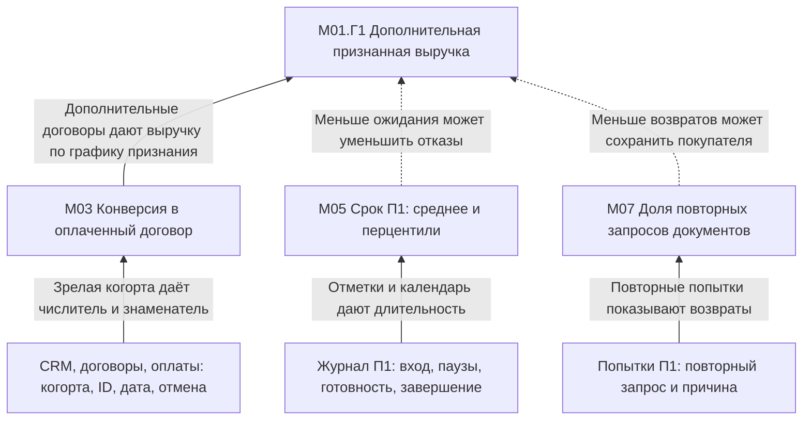
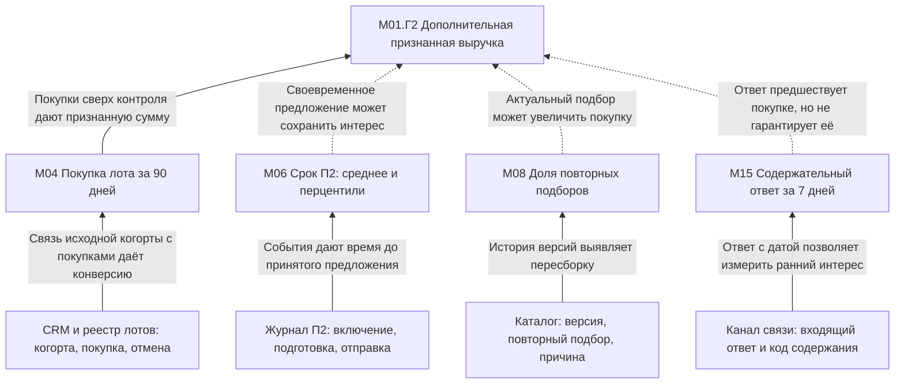
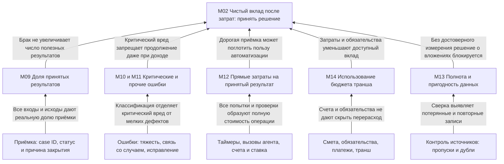

# Практическая работа №4 — Показатели, проверка модели и бюджет изменений

**Курс:** Управление информационными технологиями на предприятии  
**Семестр:** осень/зима 2026  
**Студент:** Мянчинская Ксения Олеговна  
**Дата подготовки и фиксации прогноза:** 18.11.2026, Europe/Moscow  
**Основание:** исправленная ПР2 от 18.10.2026 и ПР3 от 19.10.2026 [И1; И2].

## Краткая версия паспорта проекта — 5 строк

1. **Бизнес:** девелоперская группа LEGENDA; ООО «ЛЕГЕНДА» — управляющая организация; квартиры, паркинги и кладовые в Санкт-Петербурге и Москве.
2. **База:** консолидированная выручка 2025 года по нормативу курса **30,8 млрд ₽**; **1% = 308 млн ₽**. Все суммы модели — в ценах 2025 года.
3. **Гипотезы:** **Г1 — больше завершённых сделок**, **Г2 — дополнительные продажи лотов**; Г3–Г5 остаются в резерве.
4. **Изменения ПР3:** П1 — подготовка и приёмка пакета оформления; П2 — подготовка и отправка предложения; агент создаёт черновик, человек принимает результат.
5. **Достоверность:** внутренних журналов нет; факты из источников отделены от допущений. Сценарии и проверочная выборка синтетические; проверка на реальной истории и запуск не объявляются состоявшимися.

## 1. Управленческий вопрос и границы работы

**Вопрос руководства:** уменьшают ли новые процессы потери так, чтобы получить дополнительные оплаченные сделки и признанную выручку, сохранив качество и положительный результат после всех затрат?

Принятый пакет документов и отправленное предложение — промежуточные результаты. Они не равны продаже. Высвобождённые часы не прибавляются к прибыли без подтверждённого изменения оплаты. Дополнительные клиенты Г1 исключаются из самостоятельной базы Г2; общее ограничение оформления из ПР2 сохраняется.

Плановый старт 09.11.2026 из ПР3 **не подтверждён фактом**. В ПР4 дата 19.11.2026 используется только как условный старт будущего сценария. Если необходимые допуски не получены, прогноз отмечается «не активирован», а новый календарь оформляется отдельной версией. Годовой сценарий: 19.11.2026–18.11.2027; цикл OKR: 19.11.2026–18.05.2027.

**Ограничение обязательной процедуры:** реальная сверка с историей LEGENDA не выполнена, поскольку событийные данные не предоставлены. Выполнена воспроизводимая учебная проверка на двух разных синтетических периодах. Она проверяет механику расчёта и разделение выборок, но не заменяет подтверждение модели на компании. До его получения предлагается финансировать только сбор и проверку исходных данных.

Комплект содержит отчёт, макет экрана, `model.py`, `config.json`, размеченную синтетическую историю, результаты расчёта, неизменяемую запись прогноза и инструкцию запуска. Модель работает на стандартной библиотеке Python; для повторного построения картинки нужен matplotlib.

## 2. Дерево показателей: бизнес → процесс → сигнал

Показатели имеют сквозные коды М01–М15. На схемах стрелки направлены **от сигнала к результату**, то есть показывают предполагаемое влияние снизу вверх. Пунктир — гипотеза причинной связи, которая требует сравнения с контролем. Сплошная стрелка — правило вычисления или учёта. Поля событий на нижнем уровне не являются дополнительными самостоятельными KPI.

### 2.1. Ветка Г1 — оформление основной сделки

Два пунктирных пути описывают механизм Г1; их эффекты **не складываются** с эффектом конверсии. В модели выручка считается один раз через дополнительное число договоров. Снижение срока без прироста сделок — операционное улучшение, а не доказанный финансовый эффект.

### 2.2. Ветка Г2 — дополнительный лот

М15 нужен для прогноза поведения через месяц: 90-дневная конверсия ещё не созреет. Ответ клиента не пересчитывается в выручку отдельным множителем — иначе интерес и покупка были бы учтены дважды.

### 2.3. Ограничения результата и бюджета

М02 также использует М01 и продуктовую маржу по формуле §4. Схемы показывают разные ветки одного дерева; общий бизнес-результат не суммируется повторно по каждой стрелке.

## 3. KPI и OKR: разные задачи и защита от натягивания

### 3.1. Постоянные KPI — что нельзя ухудшить

| KPI | Уровень, который удерживаем | Как можно натянуть | Компенсация |
|---|---|---|---|
| М09 — приёмка | Не ниже подтверждённой исходной доли; учебные ориентиры П1 **95%**, П2 **90%** | Удалять сложные случаи из знаменателя, принимать формально | Знаменатель по входному реестру; учитываются закрытия, ручной резерв и просроченные незавершённые случаи; независимая выборочная проверка |
| М10 — критические ошибки | **0** подтверждённых случаев | Не регистрировать инцидент или понижать тяжесть | Независимая классификация владельцем качества/ИБ, сверка с жалобами и журналом отправок; один случай блокирует участок |
| М11 — прочие ошибки после приёмки | Не выше базы; до замера рабочий порог **1%** | Не связывать исправление с ранее принятым результатом | Единый case ID, окно последующего наблюдения 30 дней, включение исправлений после закрытия |
| М12 — прямые затраты операции | Не выше исходных **2 273,68 ₽/пакет П1**, **1 377,78 ₽/предложение П2** при сопоставимой ставке | Считать только генерацию; не учитывать отклонённые попытки и ручную проверку | Все вызовы, активные минуты, проверки и закрытия без результата в числителе; принятые уникальные результаты в знаменателе |
| М13 — пригодность данных | **≥95%** входов имеют полный корректный набор событий | Считать полноту только среди попавших в витрину | Внешний знаменатель из журнала входа/CRM; сверка потерь, дублей и поздних событий |
| М14 — транш | Факт + обязательства **≤100%** утверждённого лимита; предупреждение с **90%** | Задерживать счета, переносить расходы между проектами | Учитывать подписанные заказы и неоплаченные обязательства; сверка с финансами |

Порог — проектное предложение, а не уже действующее обязательство компании. Пока реальная база не подтверждена, показатель имеет статус «нет данных», а не зелёный. Для М05/М06 дополнительно действует ограничение P90 **в каждом значимом сегменте**; оно защищает клиентов и может блокировать расширение, даже когда цель среднего выполнена.

### 3.2. OKR на шесть месяцев

**O1. Снизить потери на оформлении и превратить улучшение процесса в дополнительные сделки.**

| Key Result | Исходная модель → цель к 18.05.2027 | Как натянуть | Защита |
|---|---|---|---|
| KR1, М03 | Конверсия 70% → **+1 п.п. к сопоставимому контролю** | Поднять цену квалификации брони, исключить отмены | Определение брони и состав когорты фиксируются до пилота; 60-дневное окно; все отмены и каналы |
| KR2, М05 | Средний цикл П1 23,8 ч → **≤8 рабочих часов**, P90 ≤24 ч в каждом сегменте | Улучшить среднее быстрыми случаями, прятать незавершённые | Перцентили и возраст незавершённой очереди по типовым/нетиповым случаям; сегмент задаётся до исхода |
| KR3, М07 | Повторные клиентские запросы 25% → **≤10%** | Не заводить новый запрос, продолжать переписку без кода | Сверка истории общения и версий документов; связь попыток с одним делом |

**O2. Увеличить дополнительные покупки без потери качества предложения и маржи.**

| Key Result | Исходная модель → цель к 18.05.2027 | Как натянуть | Защита |
|---|---|---|---|
| KR1, М04 | Покупка лота 20% → **+10 п.п. к контролю** | Отнести обычную покупку к кампании; дать чрезмерную скидку | Исходная клиентская когорта, все каналы, контроль, отмены и фактический маржинальный вклад |
| KR2, М06 | Средний цикл П2 19,833 ч → **≤2 рабочих часов**, P90 ≤8 ч в каждом сегменте | Завершить задачу до проверки каталога/отправки | Конец по подтверждённой приёмке и отправке; проверка версии и входного реестра |
| KR3, М08 | Повторный подбор 20% → **≤5%** | Считать изменение лота новым случаем | Постоянный case ID на покупателя/кампанию, история версий и причин |
| KR4, М15 | Рабочее допущение ответа 30% → **≥40% за 7 дней** | Считать автоответы, эмодзи и отказ интересом | Заранее заданные коды содержательного интереса, аудит примеров; М04 остаётся финансовой проверкой |

Это результаты, а не задачи «внедрить CRM» или «подключить агента». Недостижение амбициозного KR не равно автоматическому закрытию проекта, если качество сохранено и польза подтверждена. Закрытие определяется отдельными наблюдениями §9. Ожидаемый сценарий **уже показывает неполное достижение** KR продаж: при общей мощности прирост составит около **0,824 п.п. / 8,241 п.п.**, а не 1 / 10 п.п. Это основание для решения об узком месте, а не для изменения знаменателя.

М01 и М02 — финансовые результаты, по которым проверяется полезность обоих OKR. Годовой прогноз не подменяет шестимесячный факт; факт, прогноз до конца года и годовой сценарий выводятся раздельно.

## 4. Паспорта всех показателей

### 4.1. Общие правила отбора

**Единица:** один уникальный `case_id` одного процесса. Повторные попытки — `attempt_id` внутри случая. В Г2 включаются только существующие покупатели исходной когорты; дополнительные клиенты Г1 исключаются. Распределение «пилот/контроль» и сегмент «типовой/нетиповой» фиксируются при входе и не переписываются по результату. Нетиповой случай — заранее определённое отклонение договора/комплекта/условий лота от утверждённого шаблона, а не просто медленный случай.

Для операционных М07–М09 и М12 используется когорта входов с **десятью полными рабочими днями наблюдения**. Незавершённый к этому сроку случай не считается принятым, но его накопленные затраты включаются. М05/М06 показывают распределение завершённых траекторий **и отдельно** число/долю и возраст незавершённых из той же когорты. Когда незавершённость высока, зелёный цвет по завершённым запрещён. Для М03/М04 используются полные окна 60/90 календарных дней. Нулевой знаменатель — «нет наблюдений», не ноль процентов.

Рабочие часы считаются по единому версионированному календарю ПР3 09:00–18:00 по Москве, пн–пт с учётом праздников. Календарное время также сохраняется в детализации. Пауза клиента входит в клиентский полный цикл, но помечается причиной; исключать её ради зелёного статуса нельзя. Активный труд берётся из таймера/наблюдения, а не из времени карточки в статусе. Перцентили — **nearest rank**: элемент отсортированной выборки с номером ceil(p×n).

Функциональные роли ниже — назначаемые владельцы данных; ФИО и названия программ ещё подтверждаются компанией. Нельзя считать показатель согласованным обязательством до назначения конкретного ответственного.

### 4.2. Бизнес-результат и продажи

| Код; название и единица | Формула, записи и знаменатель | Точка съёма и владелец данных | Частота / задержка | Цель и основание | Что искажает; защита от натягивания |
|---|---|---|---|---|---|
| **М01.Г1 / М01.Г2 — дополнительная признанная выручка**, млн ₽ и % R₀ | Для каждого сегмента s: N пилота,s × (средняя признанная сумма на включённый случай в пилоте − та же сумма в контроле), затем сумма сегментов. Сумма на случай учитывает нули без продажи, скидки, возвраты и одинаковый возраст когорты; цены нормированы к 2025. % = ΔR / 30 800 ×100. Для модели — N×a×Δc×k×P×q | CRM + договоры/отмены + бухгалтерское признание; **финансовый контролёр**, совместно с коммерческим аналитиком | Предварительно ежемесячно; финальная сверка после закрытия месяца, **до 10 рабочих дней** | Норматив одного улучшения **0,2–1% R₀**; ожидаемый совместный сценарий: Г1 **140,750 млн / 0,457%**, Г2 **92,295 млн / 0,300%** после мощности. Это ориентир первого года, не текущий факт | Цены, стадии проекта, рынок, сезонность и состав лотов. Стратификация/контроль; договорная стоимость и эскроу не выдаются за выручку. Финансы подтверждают причинную атрибуцию, а не только рост строки отчётности |
| **М02 — чистый вклад инициативы**, млн ₽ | ΔR₁×m₁ + ΔR₂×m₂ + подтверждённая денежная экономия − все затраты инициативы за то же окно. В модели m общий; экономия труда =0. Для накопленного результата затраты/признание разносятся по месяцам. % вклада = вклад/R₀×100 — справочно, не коридор валового эффекта | М01, калькуляция продуктов, реестр бюджета и оплат; **финансовый директор/контролёр** | Ежемесячно, **10 рабочих дней** после закрытия | Положительный результат после полной стоимости; ожидаемый год **+30,020 млн ₽**, пессимистичный **−23,871 млн ₽**. Корпоративная маржа из ПР2 — пока только расчётная замена | Средняя маржа вместо продуктовой, скрытые расходы, перенос выручки между периодами. Факт/прогноз раздельно; обязательства и все работы включены |
| **М03 — конверсия Г1**, % и прирост в п.п. | Уникальные брони, давшие действующий договор с предусмотренной оплатой за 60 дней / все квалифицированные брони с полными 60 днями ×100. Прирост = стандартизованная по фиксированным сегментам доля пилота − контроля | CRM, реестр договоров и оплат; **руководитель продаж**, контроль определения — аналитик | Еженедельно, **T+1 день**; только созревшие когорты | База модели 70%; KR **+1 п.п.**; ожидаемо после мощности **+0,824 п.п.**. Основание — Г1 ПР2, не обещание статистической точности | Отбор «удобных» броней, незрелые когорты, отмены. Входной реестр неизменяем, условия квалификации зафиксированы; обязательны n и интервал неопределённости |
| **М04 — покупка дополнительного лота**, % и прирост в п.п. | Клиенты исходной когорты, купившие хотя бы один допустимый лот за 90 дней / все включённые подходящие клиенты с полными 90 днями ×100. Повторные лоты одного клиента не увеличивают числитель конверсии. Прирост — пилот минус контроль | CRM, каталог и договоры всех каналов; **руководитель продаж дополнительных лотов** | Еженедельно, **T+1 день**; 90-дневная зрелость | База 20%; KR **+10 п.п.**; ожидаемо после мощности **+8,241 п.п.**, по Г2 ПР2 | Переток обычных продаж, скидки, дефицит лотов. Отдельно проверяется маржа; клиент Г1 не входит в эту базу |

### 4.3. Процесс и раннее поведение

| Код; название и единица | Формула и отбор | Точка съёма и владелец | Частота / задержка | Цель и обоснование | Что искажает; защита |
|---|---|---|---|---|---|
| **М05 — полный цикл П1**, рабочие часы; среднее/P50/P90/P95 | tᵢ = рабочие часы от квалифицированной брони в оформлении до принятия пакета или закрытия с причиной; среднее = Σtᵢ/n завершённых. Перцентили — nearest rank; отдельно по каждому сегменту. Для всех зрелых входов параллельно: незавершённые/N и текущий возраст | Журнал статусов/согласования и приёмки; **руководитель оформления** | Каждый рабочий день, **T+1 день** | Среднее **≤8 ч**, P90 **≤24 ч**; P90 проверяется и по сегментам. P95 обязательно показывается; превышение 24 ч — предупреждение о хвосте. Основание — целевой процесс ПР3 | Среднее скрывает хвост, закрытие отказом ускоряет цикл, изменение календаря. М09 и причины закрытия рядом; сегмент задан до результата |
| **М06 — полный цикл П2**, рабочие часы; среднее/P50/P90/P95 | От включения клиента в допустимую кампанию до принятого отправленного предложения или закрытия с причиной. Формулы и незавершённость как у М05 | CRM, каталог, журнал приёмки и подтверждённой отправки; **руководитель дополнительных продаж** | Ежедневно, **T+1 день** | Среднее **≤2 ч**, P90 **≤8 ч** в каждом сегменте; P95 выше 8 ч — предупреждение. Из ПР3 | Ранняя отметка «готово», отсутствие отправки, потерянные случаи. Конец подтверждается событием отправки/закрытия, не ручной галочкой |
| **М07 — повторный запрос документов П1**, % | Входы П1 хотя бы с одним повторным клиентским запросом по неполноте/противоречию / все входы П1 с 10 рабочими днями наблюдения ×100. Повтор учитывается один раз на случай; число попыток хранится отдельно. Начальный запрос не считается повторным | Журнал запросов и версий документов, контроль переписки; **руководитель оформления** | Ежедневно, **T+1 день** после зрелости | **≤10%** против модельных 25%; цель ПР3. Дополнение 100%−М07 используется в прогнозе поведения | Скрытый повтор в переписке, смена кода причины; сверка сообщений и попыток, М09 не даёт «улучшать» показатель молчаливыми отказами |
| **М08 — повторный подбор П2**, % | Входы П2 с повторной подготовкой из-за изменившегося остатка/цены / все входы П2 с 10 рабочими днями наблюдения ×100 | История каталога, attempt_id и reason_code; **владелец каталога** | Ежедневно, **T+1 день** | **≤5%** против модельных 20%; цель ПР3 | Новый case ID вместо новой попытки, отсутствие причины; версия каталога и клиентская связь сохраняются |
| **М15 — содержательный ответ покупателя**, % за 7 календарных дней | Клиенты с хотя бы одним ответом «интерес к лоту / вопрос по условиям конкретного лота / согласование просмотра» за 7 дней после включения / все включённые допустимые клиенты с полными 7 днями ×100. Неотправленное предложение остаётся в знаменателе. Автоответ, эмодзи, отказ/отписка не считаются интересом | CRM и журнал входящих сообщений; автоматические даты + проверяемый код содержания; **руководитель дополнительных продаж** | Еженедельно, **T+1 день** | Допущение базы **30%**, цель **40%**; предложенный ранний признак для месячного прогноза, не цифра из источника | Ручная классификация, «вежливый ответ» вместо интереса. Аудит кодов и связь с М04; рост ответа сам по себе не признаётся выручкой |

### 4.4. Качество, стоимость и достоверность

| Код; название и единица | Формула и отбор | Точка съёма и владелец | Частота / задержка | Цель и обоснование | Что искажает; защита |
|---|---|---|---|---|---|
| **М09 — доля принятых результатов**, % по П1/П2 | Уникальные финально принятые результаты / все входы соответствующего процесса с 10 рабочими днями наблюдения ×100. Для П2 требуется отправка. Отказы, ручной резерв и просроченные незавершённые включены в знаменатель | Входной реестр, приёмка, отправки; **владельцы оформления и дополнительных продаж**, каждый за свой процесс | Ежедневно, **T+1 день** | Не ниже реальной базы; пока **95%/90%** как допущение ПР3 | Формальное принятие и удаление отказов; единый реестр и М10–М11 |
| **М10 — критические ошибки**, шт. | Число уникальных подтверждённых инцидентов: неверная цена/правовое обещание клиенту, неразрешённая отправка/действие, раскрытие ПД. Общий инцидент учитывается один раз, число затронутых случаев раскрывается отдельно. Знаменателя нет: абсолютный стоп-сигнал | Инциденты, жалобы, отправки и аудит доступа; **владелец качества**, по ПД — **ответственный ИБ** | По событию: сигнал **≤5 мин**, квалификация предварительно в течение рабочего часа; до неё участок приостановлен | **0**; ни прибыль, ни средняя точность не компенсируют критическое нарушение | Сокрытие или понижение тяжести; независимая классификация и сохранение исходных журналов |
| **М11 — некритические дефекты после приёмки**, % | Принятые результаты с подтверждённым некритическим дефектом за 30 дней / все принятые результаты с полными 30 днями наблюдения ×100; случай считается один раз | Коррекции, жалобы и QA с case ID; **руководитель качества** | Еженедельно, **T+2 дня** после сверки | Не выше подтверждённой базы; рабочий порог до замера **1%** — допущение ПР4 | Поздние находки, неполная проверка. Незрелые результаты отдельно; критические не смешиваются с этой долей |
| **М12 — прямые затраты на принятый результат**, ₽ | (Σ активных минут всех начатых случаев × полная ставка роли /60 + Σ стоимость всех агентных запусков) / принятые уникальные результаты зрелой когорты. Включены неуспешные попытки, проверки, ручной резерв; при N=0 — «не определено», затраты сохраняются | Таймеры, биллинг, приёмка и ставки; **финансовый контролёр**, поставщик трудовых данных — владельцы процессов | Еженедельно, **до T+3 дней** | Не выше базы 2 273,68 / 1 377,78 ₽; ожидаемая цель **1 371,58 / 482,22 ₽** по ПР3. Поддержка/внедрение отдельно входят в М02, поэтому это не полный TCO | Неучтённая приёмка, бесплатное время, задержка счетов, разный состав. Одна методика ставки и полный реестр входов |
| **М13 — пригодность измерения**, % | Число входов из независимого CRM-реестра с корректной связкой обязательных ID, времени и статуса / все входы реестра ×100. Для незавершённого случая допустим корректный текущий статус, а не выдуманный конец | CRM + сверка событийной витрины; **владелец данных/аналитик** | Ежедневно, **T+1 день** | **≥95%** — порог ПР3; ниже запрещено решение по эффекту | Считать только доставленные в витрину строки, маскировать дубли. Знаменатель из источника; пропуски и доля исключений раскрываются |
| **М14 — расходование транша**, % и ₽ | (Оплаченный факт + непогашенные обязательства по одобренным заказам) / утверждённый лимит транша ×100. Один счёт не считается и оплатой, и непогашенным обязательством | Бюджетный реестр, договоры/заказы, платежи; **финансовый контролёр** | Еженедельно и перед новым заказом, **T+1 рабочий день** | ≤100%; предупреждение ≥90%. Лимиты §8.4. Будущие расходы до завершения показываются рядом как прогноз, а не скрываются за свободным остатком | Перенос счета, дробление закупки и перекодировка затрат. Учёт обязательств и контроль по этапу и всей инициативе |

Для каждой записи витрины сохраняются дата среза, версия формулы и источника. Изменение правил учёта создаёт новую версию; прежний результат пересчитывается параллельно, а не исчезает. Модель не изображает фактическое наблюдение М10–М11: до получения событий их статус «нет данных».

## 5. Экран руководства: решение за минуту

### 5.1. Макет одного экрана

Верхняя строка: дата среза, режим **«факт / модель»**, сценарий, полнота и возраст данных. На экране шесть карточек и две компактные диаграммы распределения, без технического перечня всех событий. Каждый цвет сопровождается числом, границей и требуемым действием.

| Вопрос руководства | Сводка демонстрационного ожидаемого сценария | Решение |
|---|---|---|
| **Что идёт по плану?** | 🟢 Модельные средние: П1 **7,255 ≤8 ч**, П2 **1,682 ≤2 ч** | Сохранить целевую организацию типовых случаев; не объявлять это фактом внедрения |
| **Что требует решения?** | 🟡 Условный годовой вклад **+30,020 млн ₽** при бюджете **23,192 млн ₽**; реальные данные не получены | Предложить только этап 0 до **1,152 млн ₽**. Полный бюджет пока не открывать |
| **Где ограничение или ухудшение?** | 🔴 P90 нетиповых случаев **26 ч / 10 ч** при границах **24 ч / 8 ч**. В пессимистичном сценарии приёмка П2 падает **90% →80%**, стоимость результата растёт **1 377,78 →1 460 ₽** | Выделить управляемую ручную очередь исключений в рамках проектирования; повторить модель. При нарушении качества — отключить участок |
| **Можно ли доверять цвету?** | ⚪ Сверка с реальной историей **не проведена** | Нет данных — нет разрешения на запуск/масштабирование, даже если сценарий финансово положителен |

Текущее состояние **реального** проекта не окрашивается зелёным по синтетической картинке. Это макет и разбор модельного прогона. В рабочем режиме до подключения источников все фактические значения — «нет данных».

### 5.2. Правила свёртки и цвета

- 🟢 — цель и защитные KPI соблюдены, данные свежие, пригодность ≥95%, наблюдений достаточно, нет красного сегмента.
- 🟡 — есть прогнозная неопределённость, малый n, предупреждение бюджета ≥90%, либо отклонение до 10% от целевой границы без критического вреда. Нужны решение/дополнительное наблюдение.
- 🔴 — критическая ошибка, превышение транша, подтверждённое ухудшение защитного KPI либо нарушение ограничения в сегменте, запрещающее масштабирование. Сегментный предел P90 — жёсткое условие допуска: 26>24 и 10>8 дают красный именно для решения о расширении, а не «допустимые 10%».
- ⚪ — нет данных, источник просрочен или определение не согласовано. Серый не входит в «процент зелёных» как успех.

Внутри каждого процесса итоговый цвет — худший из проверок качества, бюджета и сегментов, а не средний балл. Для реального сегментного P90 предлагается минимум **30 завершённых случаев**; ниже показываются n и все длительности/диапазон, статус не зелёный. Для редких критических ошибок минимум n не требуется: один подтверждённый случай достаточен для остановки.

### 5.3. Что теряется при каждой свёртке

| Свёртка | Что скрывается | Что обязательно остаётся рядом или в детализации |
|---|---|---|
| Случаи → среднее время | Длинный хвост, очередь нетиповых клиентов | P50/P90/P95, n, незавершённые и их возраст |
| Сегменты → общий цвет | Красный небольшой сегмент может исчезнуть в зелёном большинстве | Отдельные типовые/нетиповые; итог по худшему сегменту |
| Попытки → принятый результат | Неудачные генерации, ручное исправление и проверка | Все attempt ID и затраты в числителе М12 |
| Все ошибки → доля дефектов | Редкая критическая ошибка выглядит малой долей | М10 отдельно: абсолютный стоп-сигнал, не часть средней точности |
| Продажи → сумма выручки | Переток каналов, скидки, разные проекты и признание | Контроль, сегменты, отмены и бухгалтерский график; отдельно договоры/эскроу/выручка |
| Квартал → общая конверсия | Незрелые когорты и сезонность | Фиксированные окна 60/90 дней, интервалы и n, одинаковый состав |
| Бюджет → «оплачено» | Неоплаченные заказы и будущий перерасход | Обязательства, прогноз до завершения, лимит конкретного транша |
| Модель → один ожидаемый эффект | Неизвестная причинная связь и неблагоприятные исходы | Три сценария, чувствительность β, статус реальной валидации |

### 5.4. Две ключевые метрики — распределения

Ниже **синтетический ожидаемый сценарий**, нормировка 100 случаев на процесс: 80 типовых и 20 нетиповых. Это не фактическая выборка и не основание утверждать статистическую устойчивость. Перцентили не выводятся из среднего: их задаёт явное распределение, сохранённое в `config.json`.

| Метрика и сегмент | n модели | Среднее, ч | P50 | P90 | P95 | Вывод |
|---|---:|---:|---:|---:|---:|---|
| М05 П1 — все | 100 | **7,255** | 5,319 | 5,319 | **26** | Среднее и общий P90 проходят; P95 показывает хвост |
| П1 — типовые | 80 | 5,319 | 5,319 | 5,319 | 5,319 | В целевых границах |
| П1 — нетиповые | 20 | **15** | 4 | **26** | **26** | P90 выше предела 24 ч; расширение запрещено |
| М06 П2 — все | 100 | **1,682** | 0,602 | 2 | **10** | Среднее и общий P90 проходят; хвост остаётся |
| П2 — типовые | 80 | 0,602 | 0,602 | 0,602 | 0,602 | В целевых границах |
| П2 — нетиповые | 20 | **6** | 2 | **10** | **10** | P90 выше предела 8 ч; расширение запрещено |

Механизм свёртки виден численно: в П1 10% случаев занимают 26 ч, а в П2 10% — 10 ч. Общий P90 при nearest rank ещё не попадает в эти последние 10%, а P95 уже попадает. Поэтому даже один общий P90 недостаточен. После выделения отдельной очереди исключений нужно повторно измерить/смоделировать распределение; показатели в этой работе задним числом не улучшены.

## 6. Модель песочницы и её проверка

### 6.1. Что модель делает

Воспроизводимый расчёт состоит из трёх связанных частей:

1. **Временная:** эмпирическое распределение времени по процессу/сегменту на периоде настройки; прогноз на контрольный период без переобучения. TO-BE и стресс задаются явными сценарными распределениями, согласованными по среднему с ПР3.
2. **Поведенческая:** условная связь уменьшения повторных запросов/подборов с дополнительной покупкой. Коэффициенты — допущения из целей ПР2, а не оценённый причинный эффект.
3. **Финансовая:** дополнительные договоры → ограничение мощности → признанная выручка → маржинальный вклад → разовые/постоянные расходы → помесячный результат и условное движение денег.

Она отвечает на вопрос «что будет **при выполнении допущений**», а не обещает результат. Проверка времени на истории сама по себе не подтверждает коэффициент влияния на конверсию.

### 6.2. Формулы и параметры

Для каждого процесса k:

**Δcₖ = βₖ × (r₀ₖ − rₖ) × min(1, Aₖ/A₀ₖ)**,

где r — доля повторного запроса П1 или подбора П2, A — конечная доля приёмки. β₁ = 0,01/(0,25−0,10) = **0,0666667**; β₂ = 0,10/(0,20−0,05) = **0,6666667**. Они выбраны так, чтобы ожидаемый процесс воспроизвёл самостоятельные цели ПР2 +1/+10 п.п. **Это калибровка на проектные цели, не доказательство зависимости.**

Расчёт ограничен диапазоном улучшения r≤r₀ и сохранёнными остальными условиями. Если реальные возвраты выше исходных, требуется отдельная оценка отрицательного эффекта и остановка по качеству; техническое ограничение снизу нулём в программе не означает отсутствия такого ущерба. Нулевой причинный эффект отдельно проверен в чувствительности.

**Dₖ = Nₖ × a × Δcₖ** — дополнительные сделки до общего ограничения.  
**z = min(1, C/(D₁+D₂))** — общий коэффициент мощности; при нулевых D принимается z=1.  
**ΔRₖ = Dₖ × z × Pₖ × qₖ** — дополнительная признанная выручка.  
**E = ΣΔRₖ × m − K₀ − Kпост − Kперем** — вклад после полной стоимости; денежная экономия труда отдельно принята равной нулю.

N₁=2 135, N₂=1 000; P₁=20 млн ₽, P₂=2 млн ₽; эти базы и ограничения достоверности перенесены из ПР2. В сценарии a — средний фактический охват годового потока, а не доля подключённых систем на конец года. Модель не повышает конверсию из-за одного уменьшения средней длительности: связь задана явно через r и β, а длительность работает ещё и как условие допуска.

### 6.3. Три сценария и запускающее событие

| Параметр | Базовый: без изменений | Ожидаемый | Пессимистичный |
|---|---:|---:|---:|
| Среднегодовой охват новым процессом a | 0% | **80%**: 4 месяца×40%, затем 8×100% | **50%**: 6 месяцев×20%, затем 6×80% |
| Возвраты П1 / повторный подбор П2 | 25% / 20% | **10% / 5%** | **22% / 17%** |
| Принято П1 / П2 | 95% / 90% | **95% / 90%** | **90% / 80%** |
| Прирост конверсии до ограничения | 0 / 0 | **1 / 10 п.п.** | **0,189 / 1,778 п.п.** |
| Общая мощность дополнительных пакетов | Не используется | **80/год** | **40/год** |
| Признание q₁/q₂ | Дополнительного эффекта нет | **50% / 70%** | **25% / 35%** |
| Маржинальный вклад m | Дополнительного эффекта нет | **22,8332%**, расчётная замена из ПР2 | **15%**, стресс |
| Вызовы на случай П1/П2 | 0 / 0 | **1,15 / 1,20** | **1,60 / 1,70** |
| Полная переменная цена запуска | 0 | **20 ₽** | **40 ₽** |
| Ответ покупателя за 7 дней, М15 | **30%**, допущение | **40%**, допущение | **25%**, допущение |

**Событие пессимистичного сценария:** нестабильная интеграция и устаревший каталог вызывают массовый ручной резерв; очередь проверяющих растёт, внедрение идёт медленнее. Дополнительно задерживается признание результатов по проектам, а скидки/состав продаж уменьшают маржинальный вклад. Это совместный стресс-набор без назначенной вероятности. Не утверждается, что технический сбой сам причинно уменьшает бухгалтерское q или маржу: эти неблагоприятные условия заданы отдельно.

Модельные средние/P90/P95:

| Сценарий | П1: среднее / P90 / P95, ч | П2: среднее / P90 / P95, ч | Прямые затраты на принятый результат П1 / П2 |
|---|---|---|---|
| Без изменений, настройка на учебной истории | **23,800 / 46,648 / 48,552** | **19,833 / 38,873 / 40,460** | **2 273,68 / 1 377,78 ₽** |
| Ожидаемый | **7,255 / 5,319 / 26,000** | **1,682 / 2,000 / 10,000** | **1 371,58 / 482,22 ₽** |
| Пессимистичный | **9,200 / 20,000 / 40,000** | **6,800 / 14,000 / 30,000** | **2 182,22 / 1 460,00 ₽** |

У базового сценария нулевые **дополнительные** бюджет и выручка; обычные расходы бизнеса не считаются нулевыми. Ожидаемый сценарий не проходит сегментный предел времени даже при положительной экономике. Пессимистичный расчёт полного года ниже показывает ущерб **при игнорировании остановки**; это не разрешённый план расходов.

### 6.4. Сверка с историей: выполненная учебная процедура

**Статус: синтетическая проверка, не реальная история LEGENDA.** Файл `data/history_synthetic.jsonl` содержит 800 записей с `source_kind=synthetic` и case ID, начинающимися с SYN. Даты обозначают учебные периоды; записи созданы для этой работы, не извлечены из CRM.

- **Настройка:** 01.07–31.08.2026 — 400 записей, по 200 на П1/П2; в каждом процессе 160 типовых и 40 нетиповых.
- **Проверка:** 01.09–31.10.2026 — другие 400 записей с непересекающимися case ID; тот же объём по сегментам.
- В настройке фиксируются условные эмпирические распределения по процессу и сегменту. На проверке используется только известный состав контрольной когорты; её длительности не участвуют в настройке. Это условная проверка времени при данном составе, а не прогноз числа новых обращений.
- Генератор задаёт месячные множители 0,98/1,02 для настройки и 1,04/1,08 для проверки. Они намеренно создают сдвиг; это тест реакции расчёта, а не оценка реальной сезонности.

**Расхождение = (прогноз − наблюдение контрольного набора) / наблюдение ×100%.** Проверочные допуски, заранее заданные для процедуры: абсолютная ошибка среднего ≤10%, P90 ≤15%, ≥30 наблюдений на оцениваемый сегмент, ≥95% полных завершённых записей. Эти допуски — учебные правила, не отраслевой стандарт.

| Процесс/сегмент | n проверки | Среднее: прогноз → учебное наблюдение, ч | Ошибка среднего | P90: прогноз → учебное наблюдение, ч | Ошибка P90 |
|---|---:|---|---:|---|---:|
| П1, все | 200 | 23,800 → 25,228 | **−5,66%** | 46,648 → 49,504 | **−5,77%** |
| П1, типовые | 160 | 17,850 → 18,921 | −5,66% | 29,131 → 30,845 | −5,56% |
| П1, нетиповые | 40 | 47,600 → 50,456 | −5,66% | 48,552 → 51,408 | −5,56% |
| П2, все | 200 | 19,833 → 21,023 | **−5,66%** | 38,873 → 41,253 | **−5,77%** |
| П2, типовые | 160 | 14,875 → 15,768 | −5,66% | 24,276 → 25,704 | −5,56% |
| П2, нетиповые | 40 | 39,667 → 42,047 | −5,66% | 40,460 → 42,840 | −5,56% |

Численные допуски на учебном наборе пройдены. В выходном файле при этом явно сохранено **`real_history_validated: false`**. Нельзя написать «модель подтверждена историей компании». Отдельные периоды предотвращают подгонку на одной выборке [И3], но синтетическое происхождение всё равно ограничивает вывод.

### 6.5. Как выполнить настоящую сверку

Владельцы оформления и дополнительных продаж предоставляют события за **июль–август** для настройки и **сентябрь–октябрь** для контроля. Аналитик до раскрытия контрольных длительностей фиксирует определения, календарь, сегменты, исключения и версию модели. Сохраняются исходные файлы, контрольные суммы, дата выгрузки и подтверждение владельца; персональные поля в модель не нужны.

Для каждого case ID нужны дата входа, процесс, сегмент, рабочая длительность, признак завершённости и полноты в едином окне наблюдения. Реальный файл подаётся отдельно: `python3 model.py --history data/history_real.jsonl --kind real --out output_real`. Программа отклоняет смешение меток synthetic/real; **переименование синтетических записей в real недопустимо**. Проверка подлинности источника требует организационного подтверждения, один флаг её не доказывает.

Если реальные ошибки превышают допуски, модель пересматривается на обучающей части. Сентябрь–октябрь после просмотра уже не считается новым независимым тестом для изменённой модели: нужен следующий закрытый период, например ноябрь, с достаточной зрелостью и ещё не просмотренными исходами. Причинная зависимость β проверяется отдельно в пилоте с контролем. Для Г1 малый поток не позволяет надёжно доказать +1 п.п. за короткий срок — ограничение ПР2/ПР3 сохраняется.

### 6.6. Чувствительность к главному неизвестному

Оба β умножены на общий коэффициент α; затраты, охват и правила мощности сохранены. Это проверяет именно риск «процесс ускорился, но покупки почти не изменились».

| α — доля предполагаемого влияния на продажи | Вклад первого года |
|---:|---:|
| 0%: влияния нет | **−23,192 млн ₽** |
| 25% | **−7,049 млн ₽** |
| 50% | **+9,094 млн ₽** |
| 100%: ожидаемое допущение | **+30,020 млн ₽** |

При прочих ожидаемых параметрах безубыточность требует примерно **35,92%** предполагаемой силы связи с продажами; ниже этого уровня годовой результат отрицателен. Это не вероятность успеха. Красный сегмент времени и критическая ошибка блокируют расширение независимо от значения α.

## 7. Прогноз до наблюдения: запись от 18.11.2026

**Идентификатор:** `PR4-LEGENDA-2026-11-18-v2`.  
**Файл:** `forecast_2026-11-18_v2.json`; дата фиксации — **18.11.2026**, часовой пояс Europe/Moscow.  
**Будущее окно наблюдения:** **19.11–18.12.2026**; разбор — **21.12.2026**.  
**Статус на дату записи:** результатов будущего периода нет; прогноз условный, не наблюдение.

**Условия применимости:** допуск базы и владельцев, начало пилота, одинаковые цены/правила, средний охват первого месяца 40%, сохранён контроль. Пока эти условия не выполнены, запись не активирована. Если старт переносится, старый прогноз сохраняется с этим исходом, а до новых наблюдений оформляется новый — даты старого файла не заменяются.

| Что ожидается через месяц | Исходное допущение | Ожидаемый прогноз | Пессимистичный прогноз | Правило проверки, заданное заранее |
|---|---:|---:|---:|---|
| **Поведение П1:** доля случаев без повторного клиентского запроса документов, 100%−М07 | 75% | **90%** | **78%** | Входы 19.11–04.12 с 10 рабочими днями наблюдения до 18.12; при n≥30 значение вне **80–100%** противоречит рабочему диапазону ожидаемого прогноза. Доля принятия М09 при этом не должна снизиться |
| **Поведение П2:** содержательный интерес покупателя за 7 дней, М15 | 30% | **40%** | **25%** | Включения 19.11–11.12 с полными 7 календарными днями; при n≥20 значение вне **25–55%** противоречит рабочему диапазону. Коды ответа и исключения фиксированы заранее |
| Время П1, М05 | 23,8 ч в исходной модели | Среднее **7,255 ч**, P95 **26 ч**, P90 нетиповых **26 ч** | Среднее **9,2 ч**, P95 **40 ч** | Для временной когорты — входы до 04.12, 10 рабочих дней наблюдения; публикуются все исходы и незавершённые. Превышение сегментного предела 24 ч блокирует расширение |
| Время П2, М06 | 19,833 ч в исходной модели | Среднее **1,682 ч**, P95 **10 ч**, P90 нетиповых **10 ч** | Среднее **6,8 ч**, P95 **30 ч** | Те же правила; предел нетипового P90 — 8 ч. На малом n показываются все значения, а не уверенный зелёный процентиль |

Интервалы 80–100% и 25–55% — **заранее выбранные рабочие допуски**, не статистические доверительные интервалы. При публикации факта к долям добавляется биномиальный интервал неопределённости и n. Попадание в широкий диапазон, включающий слабый эффект, не доказывает причинную пользу. Недостаточный n означает «недостаточно наблюдений», а не успех прогноза.

По равномерному годичному потоку ожидается около **71 входа П1 и 33 входов П2** за весь первый месяц при a=40%; зрелые подкогорты будут меньше. Поэтому +1 п.п. конверсии Г1 и +10 п.п. 90-дневной покупки Г2 **не объявляются подтверждёнными через месяц**. Годовая выручка также не является месячным наблюдением.

**Версии и сохранность.** В комплекте сохранена v1. До начала будущего окна, 18.11.2026, выполнена методическая корректировка v2: окно зрелости временных/документарных когорт увеличено с 5 до 10 рабочих дней, чтобы исходный длинный хвост не отсеивался определением. Будущие результаты при этом не наблюдались; старый файл не переписан. V2 содержит хеши конфигурации и программы. SHA-256 v2:

`82e0c6bd3e141d80bc29f6754bb982b2fbfe9e7d8dcd06b671b8afc35efc30b4`

Хеш проверяет неизменность содержания, но **не является независимым удостоверением даты**. Здесь дата зафиксирована в отчёте и файле; внешняя регистрация в OSF или подпись компании не заявляется. Любое последующее изменение оформляется новой датированной версией; исходный прогноз тоже оценивается [И4].

## 8. Бюджет, P&L и окупаемость

### 8.1. Разовые затраты

Сохранён объём ПР2: пилоты **1 760 часов**, масштабирование **2 880 часов**, всего **4 640 часов**. Ставка **3 000 ₽/час** и резерв **20%** — исходная смета ПР2. Разбивка масштабирования по видам работ ниже — проектное распределение для проверки исполнителем, не коммерческое предложение.

| Разовый блок | Часы | Расчёт без резерва, млн ₽ | Что входит |
|---|---:|---:|---|
| Обследование, определения и проектирование | 176 | **0,528** | Процессы, требования, правила измерения |
| Интеграции и развёртывание | 1 840 | **5,520** | 240 ч пилотных интерфейсов + 1 600 ч тиражирования |
| Реализация правил, шаблонов и агента | 704 | **2,112** | Разработка внутри принятого объёма, включая агентные узлы |
| Подготовка и перенос данных | 640 | **1,920** | Сопоставление полей, загрузка, сверка; без лишних ПД в модели |
| Тестирование и проектная приёмка | 800 | **2,400** | 480 ч пилотов + 320 ч масштабирования; не ежедневная приёмка клиентских результатов |
| Обучение и ввод в работу | 480 | **1,440** | 160 ч пилота + 320 ч развёртывания |
| **Итого до резерва** | **4 640** | **13,920** | — |
| Резерв 20% | — | **2,784** | Уточнение состава и полной цены |
| **Ожидаемые разовые K₀** | — | **16,704** | В помесячной модели консервативно отнесены на месяц 0 |
| **Пессимистичные K₀** | — | **18,3744** | Ещё +10% к полной разовой смете при осложнении интеграций; превышает ожидаемый лимит и требует остановки/пересмотра |

Затраты на сбор данных не добавлены повторно поверх этой сметы: этап 0 — **320 часов** из её состава (176 ч обследования + 80 ч интеграции + 64 ч проверки). Ни один из этих бюджетов не является уже понесённым расходом.

### 8.2. Постоянные и переменные затраты первого года

| Блок | Основание | Ожидаемый, млн ₽ | Пессимистичный, млн ₽ |
|---|---|---:|---:|
| Поддержка и администрирование | 1 440 ч/год ×3 000 ₽ ×1,2; в стрессе часов на 25% больше | **5,184000** | **6,480000** |
| Лицензии | Плановый лимит 10 тыс. ₽/месяц, включая полную стоимость; требуется предложение | **0,120000** | **0,120000** |
| Дополнительная инфраструктура и журналирование | Плановый лимит 20 тыс. ₽/месяц; требуется оценка размещения | **0,240000** | **0,240000** |
| Все агентные запуски | ΣN×a×число запусков×цена. Ожидаемо 2 924,2 расчётного запуска ×20 ₽; стресс 2 558×40 ₽ | **0,058484** | **0,102320** |
| Человеческая проверка и финальная приёмка | П1: 19,2 мин/вход; П2: 11,2; ставка 1 200 ₽/ч. Стресс: 28,8 /18,2 мин | **0,835072** | **0,796880** |
| Ручное выполнение при отказе от агента | Ожидаемо 1 мин в среднем на каждый вход; стресс П1 6 мин, П2 8 мин | **0,050160** | **0,208100** |
| **Всего эксплуатация** | Все попытки, независимо от приёмки | **6,487716** | **7,947300** |
| **Полный бюджет первого года** | Разовые + эксплуатация | **23,191716** | **26,321700** |

В стрессовом сценарии приёмка на один вход дороже, но годовой охват ниже; поэтому её общая сумма может быть меньше. Это не экономия за счёт качества. Дробное число вызовов — расчёт интенсивности годового потока, а фактический счёт будет по целым операциям.

**Отличие от ПР3:** к 21,946484 млн ₽ добавлены 0,360 млн ₽ лицензий/инфраструктуры и **0,885232 млн ₽** приёмки/ручного резерва. Эти статьи больше не остаются условно бесплатными. Для бюджета консервативно резервируется **весь** новый ресурс операционной приёмки без вычитания высвобождаемого старого ФОТ. Финансы должны исключить двойное начисление одной и той же зарплаты в реальном бюджете: если работа укладывается в существующую оплачиваемую ёмкость, она показывается как занятая мощность, а не второй платёж. Пока подтверждения нет, сценарий использует верхнюю оценку нового финансирования.

Ставка 1 200 ₽/ч и цены запусков — допущения ПР3; лицензии и инфраструктура — новые **бюджетные лимиты**, не найденные прайсы. До закупки необходима полная смета, включая применимые налоги. Реальные номинальные суммы приводятся к ценам 2025 года по согласованной с финансами методике. При невозможности уложиться в лимит пересчитывается бюджет, а не скрывается статья.

### 8.3. Эффект по строкам P&L и отраслевой коридор

| Строка / результат | Без изменений | Ожидаемый | Пессимистичный |
|---|---:|---:|---:|
| Дополнительная признанная выручка Г1 | 0 | **140,750 млн ₽ / 0,457% R₀** | **10,113 млн ₽ / 0,0328% R₀** |
| Дополнительная признанная выручка Г2 | 0 | **92,295 млн ₽ / 0,300% R₀** | **6,222 млн ₽ / 0,0202% R₀** |
| Сравнение каждого улучшения с 0,2–1% | Эффекта нет | Оба внутри коридора | Оба ниже коридора |
| Всего дополнительная выручка | 0 | **233,045 млн ₽ / 0,757% R₀** | **16,335 млн ₽ / 0,0530% R₀** |
| Денежное снижение статьи расходов | 0 | **0 — не подтверждено** | **0 — не подтверждено** |
| Маржинальный вклад до бюджета | 0 | **53,212 млн ₽** | **2,450 млн ₽** |
| Полная стоимость инициативы | 0 дополнительных | **23,192 млн ₽** | **26,322 млн ₽** |
| **Вклад после затрат** | **0 дополнительных** | **+30,020 млн ₽** | **−23,871 млн ₽** |

В ожидаемом случае общая мощность ограничивает самостоятельные 170,8+112 млн ₽: z=80/97,08=**0,8240626**. В стрессовом случае потенциальных дополнительных пакетов лишь 10,912, поэтому мощность 40 не ограничивает поток, z=1. Сумма двух инициатив справочно выражена в % R₀, но **коридор «пять улучшений» 0,5–2,5% к паре не применяется**.

Если агент ускорил работу, но продажи не изменились, валовой финансовый эффект равен нулю, а бюджет остаётся расходом. Сценарная экономия времени не добавлена к выручке и не названа снижением себестоимости строительства.

### 8.4. Финансирование по этапам

| Этап | Лимит и состав | Условие открытия | Когда дальше не тратим |
|---|---|---|---|
| **0. Данные и проверка модели** | **1,152 млн ₽** =320 ч×3 000×1,2; входит в разовые затраты | Назначены владельцы, доступ к нужным обезличенным событиям реалистичен | Историю получить нельзя или измерение не восстанавливается: не открывать пилот; зафиксировать стоимость и причину |
| **1. Ограниченный пилот и наблюдение до 6 месяцев** | Дополнительные пилотные работы **5,184 млн ₽**; вместе с этапом 0 весь пилотный разовый блок **6,336 млн ₽**. Общий накопленный лимит этапов 0–1 с эксплуатацией — **10,000 млн ₽**, включая до 3,664 млн ₽ эксплуатации | Настройка/контроль на разных реальных периодах пройдены, права и ручной режим проверены, прогноз сохранён до новых наблюдений | Критические ошибки, нарушение качества, невоспроизводимая база, исчерпан транш или к концу цикла нет проверяемого основания продолжать |
| **2. Масштабирование** | Разовые работы **10,368 млн ₽**; остальные расходы — в пределах общего годового лимита **23,191716 млн ₽** | Защитные KPI и сегменты проходят; экономика пересчитана по наблюдениям; узкое место и полный остаток бюджета согласованы | Красный сегмент, неподтверждённая прибыльность или требование увеличить лимит без новой проверки |

Лимиты этапов **не складываются как независимые бюджеты**: 1,152 входит в 6,336; расходы пилота входят в годовые 23,191716. Полный сценарий с a=80% — расчёт возможного развёртывания, **не автоматически разрешённый календарь**. Фактическая дата каждого допуска меняет помесячный охват и требует нового расчёта.

По текущим данным рекомендуется только подготовка этапа 0. Даже ожидаемый прогон не разрешает массовый запуск: нет реальной валидации и превышены ограничения нетиповых случаев.

### 8.5. Окупаемость: два разных смысла

Модель считает 24 месяца. Разовый бюджет консервативно платится в месяце 0. Фиксированные расходы распределены равномерно; переменные — пропорционально фактическому охвату. Маржинальный эффект признанной выручки в первом году распределён по весам охвата; это плановая аппроксимация, которую должен заменить график конкретных проектов. Во втором году охват: ожидаемо 100%, стресс 80%; годовая мощность остаётся 80/40, а не растёт бесплатно. Непризнанный остаток не добавляется отдельным терминальным доходом.

**Учётная окупаемость** — первый месяц, когда накопленный маржинальный эффект признанной выручки покрывает накопленные затраты. **Условная денежная окупаемость** — то же при отдельном допущении, что соответствующий денежный эффект доступен на **6 месяцев позже** признания. Это стресс временного разрыва, не установленный график раскрытия эскроу. До данных проектов настоящая денежная окупаемость компании неизвестна.

| Вид оценки | Ожидаемый сценарий | Пессимистичный |
|---|---|---|
| Покрытие затрат маржинальным эффектом | **6-й месяц** после условного старта | **Не достигается за 24 месяца** |
| Денежная окупаемость при лаге 6 месяцев | **13-й месяц** | **Не достигается за 24 месяца** |
| Накопленный денежный результат к месяцу 12 | **−3,237 млн ₽** | **−25,832 млн ₽**, если не остановить |
| Максимальная потребность в финансировании ожидаемого сценария | **19,830 млн ₽** в пределах модельного графика | Убыток продолжает накапливаться; не повод выделять новые деньги |

Контрольные точки расчёта, млн ₽:

| Месяц | Ожидаемый: учётный итог | Ожидаемый: условный денежный итог | Пессимистичный: учётный итог | Пессимистичный: денежный итог |
|---:|---:|---:|---:|---:|
| 0 | −16,704 | −16,704 | −18,374 | −18,374 |
| 4 | −9,841 | −18,709 | −20,475 | −20,802 |
| 6 | **+0,124** | −19,830 | −21,526 | −22,016 |
| 12 | **+30,020** | −3,237 | −23,871 | −25,832 |
| 13 | +33,894 | **+1,745** | −24,262 | −26,223 |
| 24 | +76,508 | +49,902 | −28,563 | −30,523 |

Все значения воспроизводятся в `output/scenarios.json`. Это простой срок окупаемости без дисконтирования и полноценного проектного cash flow: налоги, кредитные условия и оборотный капитал отдельно не моделируются. Их фактическое влияние требует уточнения перед инвестиционным решением. Пессимистичный двухлетний расчёт — иллюстрация последствий отсутствия остановки, а не утверждённая смета.

## 9. Критерии остановки — наблюдение, действие и владелец

| Наблюдение | Что прекращается | Владелец решения / срок | Условия возможного возобновления |
|---|---|---|---|
| Нет реальной контрольной выборки; ошибка модели выше допусков; М13 <95% | Открытие следующего транша и выводы об эффекте | Владелец данных + финдиректор, **до следующего заказа** | Восстановлен источник, пройдена проверка на отдельном ещё не использованном для настройки периоде |
| **Хотя бы одна критическая ошибка М10** | Агентный/автоматизированный участок; действует ручной маршрут | Владелец процесса и ИБ/качество: **немедленная приостановка после сигнала**, оценка в течение рабочего часа | Причина устранена, затронутые случаи проверены, проведены повторный тест и явный допуск владельца |
| М09 ниже базы — сначала запрет расширения; снижение **≥3 п.п.** за зрелое 4-недельное окно при n≥30 | Экспериментальный участок переводится в ручной режим | Владелец процесса, **следующий рабочий день** | Проверено качество, снята причина, новая ограниченная проверка с заранее заданным критерием |
| P90 любого значимого сегмента выше 24 ч/8 ч | Масштабирование; для сегмента вводится ручное управление очередью | Руководитель оформления/продаж, **еженедельный разбор** | Сегмент прошёл целевое ограничение на достаточной выборке; при малом n зелёный допуск не выдаётся |
| М11 >1% либо выше подтверждённой базы; рост повторяется в двух последовательных зрелых 4-недельных окнах | Расширение; при подтверждённой причине — агентная функция | Руководитель качества совместно с владельцем, **следующий рабочий день после разбора** | Исправления и контрольная проверка, все поздние дефекты остаются в истории |
| М12 выше базы **более чем на 10%** в двух зрелых 4-недельных окнах при n≥30, без компенсирующего подтверждённого вклада | Использование агента в данном узле; обычная автоматизация оценивается отдельно | Владелец процесса и финконтролёр, **до нового периода расходов** | Упрощённое решение показывает стоимость ниже базы при том же качестве |
| М14 достиг 100% лимита либо новый заказ его превысит | Новые необязательные заказы и расширение; обязательные действия по восстановлению не скрываются | Финансовый контролёр, **до обязательства** | Новая обоснованная смета и решение уполномоченного руководителя; автоматического пополнения нет |
| К концу шестимесячного цикла нет пригодной базы/зрелых наблюдений, а лимит пилота исчерпан | Пилот не продлевается автоматически | Спонсор и финдиректор, **итоговый разбор цикла** | Новая самостоятельная заявка с объяснением ценности дополнительного наблюдения и отдельным лимитом |
| На наблюдаемых параметрах ожидаемый годовой вклад ≤0; либо лучший обоснованный исход не покрывает оставшиеся избегаемые затраты | Масштабирование/инициатива; уже потраченные деньги не являются доводом «дожать» | Спонсор и финдиректор, **на ближайшем бюджетном решении** | Существенно изменённый объём/стоимость и новая проверка; старый отрицательный результат сохраняется |

Недостаточная статистическая мощность не означает доказанного отсутствия эффекта. Но она также не даёт разрешения бесконечно расходовать бюджет. Различаются: **«гипотеза опровергнута»**, **«данных недостаточно»**, **«продолжение нецелесообразно при доступном лимите»**. Решение фиксирует одну из этих причин, владельца и дату.

## 10. Реестр оснований и проверок перед расходами

Все значения ниже — входы модели, а не замеры компании. Ссылка на ПР2/ПР3 означает перенос их расчётного основания и ограничения достоверности; публичная отчётность не подтверждает внутренние конверсии или длительности.

| Вход / допущение | Конкретное происхождение | Кто проверяет | Чем и когда подтверждается |
|---|---|---|---|
| R₀=30 800 млн ₽; 1%=308 млн ₽ | Коридор курса и финансовая база исправленной ПР2 [И1; И5] | Финансовый контролёр | Сверка периметра группы и отчётности за 2025 год, этап 0 |
| N₁=2 135, N₂=1 000; базы конверсии 70%/20%; цены 20/2 млн ₽ | Расчётная воронка и базы Г1/Г2 исправленной ПР2 [И1] | Коммерческий аналитик и владельцы продаж | CRM, договоры, отмены, реестр допустимых клиентов; сверка 12-месячного потока и исключение пересечения Г1/Г2 |
| Возвраты 25%→10% / 20%→5%; приёмка 95%/90%; труд и средние сроки | Исходная и целевая калькуляции процессов ПР3 [И2] | Руководители оформления/дополнительных продаж | Событийный журнал + наблюдение активного труда, отдельные настройка/контроль; до допуска пилота |
| β₁=0,0667, β₂=0,6667 | **Обратный расчёт** от целевых приростов ПР2 и изменения возвратов ПР3, формула §6.2 | Аналитик эксперимента и финансовый контролёр | Созревшие 60/90-дневные когорты пилота и контроля; до утверждения эффекта. Самое критичное неизвестное |
| 80%/50% охвата; C=80/40 | Ожидаемые охват и общая мощность — ограничения ПР2; помесячный профиль и стресс заданы в §6.3 | Владелец оформления и руководитель внедрения | Реестр входов, загрузка, план доступной мощности; уточнение календаря при каждом транше |
| q=50%/70%; m=22,8332% | Доли признания и финансовый расчёт ПР2; m — замена отсутствующей продуктовой маржи | Финансовый директор | Графики признания конкретных объектов и калькуляция предельного вклада Г1/Г2; до инвестиционного решения |
| q=25%/35%, m=15% в стрессе | Явный неблагоприятный сценарий, не отраслевой прогноз | Финансовый директор | Проверка возможной задержки и состава продаж; вероятность здесь не назначена |
| 80/20 типовых/нетиповых; дискретные длительности TO-BE; учебный месячный сдвиг | Специально сконструированное распределение `config.json` и генератор `model.py`; средние TO-BE сохранены из ПР3 | Аналитик процессов | Реальная эмпирическая гистограмма и возраст незавершённых. Учебное распределение не переносится в факт |
| 4 640 ч, 1 440 ч поддержки; 3 000 ₽/ч; резерв 20% | Сметная структура исправленной ПР2; детализация видов работ §8.1 | Руководитель ИТ и закупки | Задание, оценка исполнителя и коммерческое предложение; этап 0 и до заказа каждого транша |
| 1 200 ₽/ч, приёмка 19,2/11,2 мин, 1,15/1,20 запуска по 20 ₽ | Калькуляция человеко-времени и запусков ПР3; все попытки включены | Владельцы процессов, HR/финансы, ИТ | Таймер, журнал запусков, стоимость занятого ресурса и счёт поставщика; отдельно проверка фактического прироста оплачиваемых часов |
| Лицензии 0,12; инфраструктура 0,24 млн ₽/год | **Бюджетные лимиты**, 10/20 тыс. ₽ в месяц; это новые предположения ПР4, не тариф поставщика | Закупки и ИТ | Предложения с полной ценой; если не укладываются — пересчёт, а не сохранение удобной суммы |
| Денежный лаг 6 месяцев | Допущение для отличия признанного результата от денежных поступлений, не норматив девелопера | Казначейство | График раскрытия эскроу/поступлений и расходов по затронутым проектам; до обещания денежной окупаемости |
| М15: 30%→40%; стресс 25% | Новый ранний поведенческий прогноз ПР4, не полученный из отчётности | Руководитель дополнительных продаж | Содержательные ответы и аудит классификации в заранее заданном месячном окне |
| Пределы ошибки модели, n, сегментный P90 и лимиты траншей | Предлагаемые правила принятия решения §4–9, а не подтверждённый корпоративный SLA | Спонсор, владельцы процессов и финансовый директор | Явное назначение ответственных и согласование до пилота; изменение порога сохраняется отдельной версией |

## 11. Источники и состав воспроизводимого комплекта

- **И1. Исправленная ПР2 — «Гипотезы LEGENDA».** Использована доступная версия с датой 18.10.2026: состав Г1/Г2, базы, ограничения мощности, маржинальный расчёт и смета. [Открыть исходный документ](https://chatgpt.com/library?file_id=libfile_174785d595c481919e5b069316fe1da8&account_id=personal).
- **И2. ПР3 — «Процессы LEGENDA».** Доступная версия с датой 19.10.2026: два процесса, время, возвраты, приёмка и стоимость агента. [Открыть исходный документ](https://chatgpt.com/library?file_id=libfile_bffa5b21f848819184c6171ece0633d6&account_id=personal).
- **И3. scikit-learn, TimeSeriesSplit.** Методическое основание разделять настройку и проверку во времени, не обучая модель на будущих данных. [Официальная документация](https://scikit-learn.org/stable/modules/generated/sklearn.model_selection.TimeSeriesSplit.html). Библиотека в программе не используется; расчёт выполнен стандартными средствами Python.
- **И4. Center for Open Science, Preregistration.** Основание фиксировать ожидания до исходов и прозрачно сохранять изменения плана. [Описание предварительной регистрации](https://www.cos.io/initiatives/prereg); [пояснение об изменениях плана](https://www.cos.io/blog/preregistration-plan-not-prison). Внешняя регистрация этой работы не выполнена.
- **И5. Задание ПР4 и отраслевой коридор LEGENDA**, предоставленные преподавателем через материалы задания: 0,2–1% выручки для одного улучшения; 0,5–2,5% для набора из пяти. Норматив принят как условие курса, не как прогноз компании.

Ссылки И3–И4 использованы для методики, а не в качестве источника чисел LEGENDA. Численные основания и новые допущения перечислены отдельно в §10.

| Файл в комплекте | Назначение |
|---|---|
| `ПР4_Показатели_модель_бюджет_ЛЕГЕНДА.md` | Основной отчёт; три дерева Mermaid находятся непосредственно в тексте |
| `Экран_руководства_ПР4.png` | Один экран сценарного решения; явно подписан как модель |
| `model.py`, `config.json` | Программа и открытые параметры трёх сценариев |
| `data/history_synthetic.jsonl` | 800 явно синтетических записей; не журнал компании |
| `output/validation.json`, `output/scenarios.json` | Расхождения на разных периодах, распределения, бюджет, помесячный результат |
| `forecast_2026-11-18_v2.json`, `.sha256` | Действующая предварительная запись и проверка целостности; v1 также сохранена |
| `README.md`, `verify_model.py`, `render_dashboard.py` | Инструкция, проверки критичных свойств расчёта и построение экрана |

## 12. Решение по работе и незакрытый критерий

Предлагается **этап 0 в пределах 1,152 млн ₽** для получения базы и проверки применимости. Полное внедрение сейчас не обосновано: при положительном ожидаемом вкладе сохраняются красные сегменты времени, а причинный коэффициент продаж и реальная история не подтверждены. Это предложение бюджету, не состоявшееся одобрение или платёж.

| Требование ПР4 | Что предъявлено | Статус |
|---|---|---|
| Дерево из трёх уровней с подписанными связями | §2, три диаграммы Mermaid | Выполнено |
| KPI/OKR, риск натягивания, паспорта | §3–4: формулы, источники, владельцы, частота, цели и искажения | Выполнено как проект системы; назначение ФИО — до запуска |
| Один экран и потери свёртки; две метрики с распределениями | §5 и PNG; П1/П2, P50/P90/P95 и сегменты | Выполнено на сценарных данных |
| Три сценария и раздельные периоды настройки/проверки | §6 и исполняемая модель | Учебная процедура выполнена |
| **Сверка с реальной историей компании** | §6.5 — протокол, схема данных, ответственные и допуски | **Открыто: реальные журналы не предоставлены; синтетика не заменяет этот критерий** |
| Прогноз до наблюдения | §7, датированный файл v2 от 18.11.2026 на будущий месяц | Зафиксирован условный прогноз; активация и будущая проверка ещё не состоялись |
| Детальный бюджет, окупаемость и остановки | §8–9; ожидаемый и пессимистичный варианты | Выполнено как модель, с явными условиями применимости |

Работа даёт проверяемую систему решений, но не приписывает LEGENDA проведённый пилот или измеренный экономический эффект. Реальный критерий истории нельзя честно закрыть без исходных данных.
