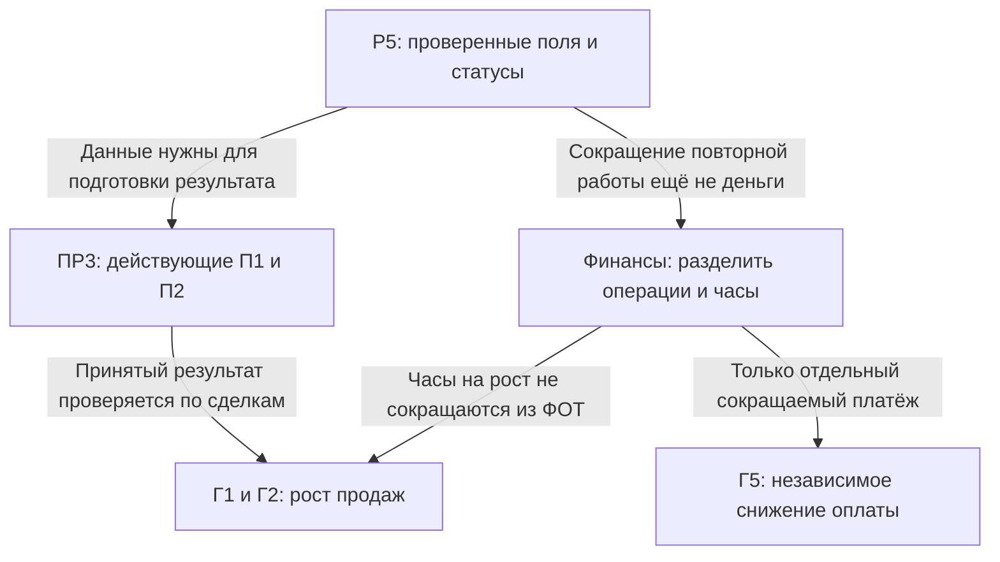
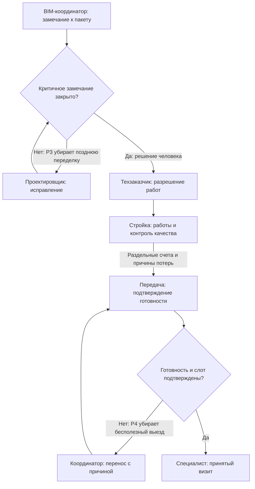

# Практическая работа №5 — Пять улучшений и защита портфеля LEGENDA

**Курс:** Управление информационными технологиями на предприятии  
**Семестр:** осень/зима 2026  
**Студент:** Мянчинская Ксения Олеговна  
**Дата:** 18.11.2026  
**Основание:** исправленная ПР2 от 18.10.2026, ПР3 от 19.10.2026 и ПР4 от 18.11.2026 [И1–И3].

## Краткая версия паспорта — 5 строк

1. **Бизнес:** группа LEGENDA, девелопмент жилья, паркингов и кладовых; периметр расчёта — группа, не отдельное ООО.
2. **База:** выручка 2025 года по нормативу курса **30,8 млрд ₽**; **1%=308 млн ₽**; все эффекты годовые в ценах 2025 года.
3. **Пятёрка:** Г1 — оформление сделок; Г2 — дополнительные лоты; Г3 — строительные переделки; Г4 — повторные приёмки; Г5 — повторная обработка документов.
4. **Процессы:** П1/П2 из ПР3 разработаны для Г1/Г2; резервные Г3–Г5 получают явное процессное дополнение в приложении А этой работы.
5. **Статус доказательств:** реальный пилот и сверка с журналами компании не проведены; цифры — сценарные оценки с открытыми допущениями, не достигнутые результаты.

## 1. Решение, предлагаемое руководству

**Не запускать все пять одновременно.** Условный валовой эффект пятёрки после ограничения мощности и консервативного исключения пересечения — **248,104 млн ₽, или 0,806% выручки**. Это внутри коридора 0,5–2,5%, но такой результат требует ресурса на все пять инициатив и ещё не подтверждён пользователями.

Полная пятёрка потребует **не менее 57,003 млн ₽** первого года и **15 472 часов** проектирования, внедрения и поддержки. При принятых параметрах её вклад после затрат — **не более 11,267 млн ₽** до уточнения дополнительных расходов резервных инициатив. Выбранная в ПР3 пара Г1+Г2 даёт условные **+30,020 млн ₽** при бюджете **23,192 млн ₽**. Поэтому наличие положительной портфельной суммы не оправдывает запуск слабых инициатив.

Первое решение — **этап 0, до 1,152 млн ₽**, на достоверную базу и проверку измерения. После допуска предлагается сначала контролируемый пилот Г2: его финансовую метрику реально проверить на доступном потоке примерно за год. Г1 сохраняется среди выбранных гипотез, но короткий пилот не способен надёжно доказать +1 п.п. конверсии. Г3–Г5 остаются резервом. Ни один бюджет здесь не считается согласованным или потраченным.

## 2. Диагноз ИТ-функции и трассировка

Предварительный диагноз ПР1/ПР3 — **ИТ как партнёр бизнеса, зона 🟡**. Признак: у компании уже есть цифровые инструменты, в том числе BIM и LEGENDA ACCEPTANCE, и опубликованы запросы на развитие процессов [И1; И2; И6]. Предложение состоит в изменении переходов, правил и измерения эффекта, а не в покупке очередной системы с нуля.

**Диагноз не равен аудиту компании.** Материалы проекта не позволяют связать журналы использования ИТ с дополнительной признанной выручкой и реально уменьшенными платежами. Это пробел доказательств проекта, а не установленное отсутствие управленческого учёта у LEGENDA. Модельные ожидания П1/П2 из ПР3 — 1 320 и 1 128 рабочих минут — также не выданы за реальные замеры.

| Улучшение | Гипотеза и процессная связь | Конкретное изменение | Статус к ПР5 |
|---|---|---|---|
| У1 — завершение основной сделки | Г1; ПР2 §4.1; **П1 ПР3** | Проверка комплектности, единый статус, маршрутизация и человеческая приёмка пакета | Процесс спроектирован, модель есть; пилот не проведён |
| У2 — покупка дополнительного лота | Г2; ПР2 §4.2; **П2 ПР3** | Актуальный каталог, подходящий лот, проверяемый черновик предложения, отправка человеком | Процесс спроектирован; основной кандидат на финансовый пилот |
| У3 — предотвращение переделок | Г3; ПР2 §4.3; **Р3, приложение А** | Блокировка разрешения на соответствующие работы до закрытия критичных замечаний | Резерв. В ПР3 отдельный строительный процесс не моделировался |
| У4 — готовность к повторной приёмке | Г4; ПР2 §4.4; **Р4, приложение А** | Подтверждение готовности замечаний и слота до повторного выезда | Резерв. Продолжение пути после сделки, не часть П1/П2 |
| У5 — устранение повторного ввода | Г5; ПР2 §4.5; шаги данных и приёмки **П1 ПР3**, **Р5, приложение А** | Передача проверенных полей и статусов; отдельное доказательство уменьшения оплаты | Резерв. Часть механизма уже нужна Г1; отдельная экономия не доказана |

Приложение А — новое процессное дополнение к цепочке ПР3–ПР5. Оно не означает, что резервные инициативы были внедрены или проверены в ПР3/ПР4. Это устраняет разрыв трассировки, сохраняя исходный выбор двух процессов.

## 3. Пять улучшений: эффект, происхождение и уверенность

Сначала показан **самостоятельный** эффект каждой инициативы при её собственных условиях. Проценты выручки и проценты статьи затрат **не складываются**. Вся арифметика воспроизводится файлом `Расчёт_ПР5.py`.

| Улучшение / гипотеза | Строка P&L и знаменатель | Самостоятельный годовой эффект | Как получен | Коридор | Уверенность и ограничение |
|---|---|---:|---|---|---|
| **У1 / Г1. Завершение сделок** | Признанная выручка; R₀=30 800 млн ₽ | **170,800 млн ₽; 0,555% R₀** | 2 135 броней ×1 п.п. ×20 млн ₽ ×80% охвата ×50% признания; ПР2 §5.2, ПР4 §6 | **Внутри 0,2–1%** | **Низкая для финансового эффекта.** Поток восстановлен, конверсия и отклик не измерены. Расчёт воспроизводим, но это не эмпирическая уверенность |
| **У2 / Г2. Дополнительные лоты** | Признанная выручка; R₀ | **112,000 млн ₽; 0,364% R₀** | 1 000 прежних клиентов ×10 п.п. ×2 млн ₽ ×80% ×70%; ПР2 §5.3, ПР4 | **Внутри 0,2–1%** | **Низкая.** Нет продуктовой маржи и подтверждения дополнительности покупок; контролируемый пилот выполним по модельному потоку |
| **У3 / Г3. Переделки** | Строительная себестоимость; C₃=13 499,300 млн ₽ | **10,259 млн ₽; 0,076% C₃** | C₃×0,38% потерь×1/3 предотвращения×80%×75% списания в P&L | **Ниже 0,5–3%** | **Низкая.** Денежная база из МСФО, потери — внешний аналог с другим знаменателем. При K=22,752 млн ₽ результат **−12,493 млн ₽** |
| **У4 / Г4. Повторные приёмки** | Коммерческие расходы службы передачи; C₄=59,9897 млн ₽ | **4,799 млн ₽; 8,000% C₄** | C₄×40% изменяемой части×25% сокращения×80% охвата | **Внутри 2–10%** | **Низкая.** Аллокация ФОТ и переменность оплаты неизвестны. Условный результат после K=3,5712: **+1,228 млн ₽** до возможных новых расходов |
| **У5 / Г5. Повторные документы** | Управленческие расходы сопровождения; C₅=157,6106 млн ₽ | **7,092 млн ₽; 4,500% C₅** | C₅×30% повторной работы×40% сокращения×75% охвата×50% монетизации | **Внутри 2–10%** | **Низкая.** Сокращение времени не равно уменьшению ФОТ. После K=7,488: **−0,396 млн ₽**; в совместном расчёте эффект исключён до разметки пересечения |

**Почему низкая уверенность у всех пяти:** открытая отчётность подтверждает масштаб и часть финансовых баз, но не причинную реакцию клиентов, фактические потери и заменяемость оплаты. Изменение статуса на «средняя» требует хотя бы реальной базы и устойчивого процессного результата; финансовую уверенность повышает контролируемое наблюдение созревших исходов. Синтетическая сверка ПР4 этого не делает.

### 3.1. Откуда взялись ключевые числа

- **2 135 броней:** 74 000 м² ×0,404 млн ₽/м² /20 млн ₽ за квартиру /0,70 ≈2 135,43; округление до 2 135. Первые три значения — публичные итоги компании [И5], 70% — середина внешнего практического диапазона 60–80%, перенесённого в ПР2. CRM не предоставлена.
- **1 000 клиентов Г2, чек 2 млн ₽, +1/+10 п.п., охват и q:** сценарные входы исправленной ПР2. Источник расчёта известен, но это не раскрытая статистика LEGENDA.
- **C₃:** строка «Затраты на строительство» из примечания 16 МСФО 2025 в ПР2. **C₄=(503,720+96,177)×10%=59,9897**; **C₅=(1 323,304+252,802)×10%=157,6106**. Фонды и начисления взяты из примечаний 17–18, доли 10% — неподтверждённое распределение функций [И1; И7].
- **0,38%:** открытая аннотация исследования Peter E. D. Love о переделках до завершения строительства [И8]. Знаменатель исследования — стоимость контракта, здесь — строительная статья. Перенос с коэффициентом 1 остаётся допущением; постстроительные исправления не добавлены ради красивого эффекта.
- **Маржинальный коэффициент m:** (24 478,350−17 986,715−902,434)/24 478,350 = **22,8332%**. 24 478,350=30 756,106−6 277,756: из точной выручки исключена включённая процентная экономия, как в ПР2. Это средняя расчётная замена, не продуктовая предельная маржа [И1; И7].
- **3 000 ₽/ч, часы и резерв 20%:** внешний ориентир ставки подрядчика и инженерная смета по объектам работ из ПР2 §6.2. Нормировка 160 ч/человеко-месяц — плановая, не календарная норма. Часы, ставки и полная цена требуют коммерческой оценки.

Г3 ниже коридора и не окупает первый год. Поэтому она остаётся диагностической задачей. При остальных параметрах нужны потери **выше 0,8427%** для покрытия её K и **не менее 2,5%** для нижней границы коридора. Факта таких потерь нет. Объяснение «внедрим BIM» не подходит: BIM уже действует.

## 4. Совокупный эффект: пересечения, усиление, мощность

### 4.1. Реестр взаимодействий

| Связь | Почему эффекты не независимы | Правило учёта | Чем проверить |
|---|---|---|---|
| Г1 и Г2 | Новый покупатель квартиры может купить паркинг, и обе гипотезы припишут себе клиента | Г2 включает только исходную когорту существующих покупателей. Новые клиенты Г1 не входят в N₂; дополнительный перекрёстный эффект =0 | Единый customer ID, дата входа в когорту, договоры всех каналов |
| Г1/П1 и Г5 | Оба изменения устраняют повторную обработку. Высвобождённое время может потребоваться для обслуживания дополнительных сделок, а не для сокращения оплаты | До карты операций **весь самостоятельный S₅=7,092477 исключён из защищаемого совместного результата**. Это консервативная граница неизвестного пересечения, не утверждение о фактическом 100%-ном дубле | Реестр «операция—сотрудник—часы—оплата—инициатива»; финконтролёр исключает повторный учёт и несовместимое использование часов |
| Г3 и Г4 | Меньше дефектов может уменьшить повторные визиты | Г3: только строительные переделки. Г4: только организационная неготовность/неявки и коммерческая оплата. Дополнительный эффект от качества строительства в Г4 не учитывается | Причины визитов, акты работ, разные счета и центры затрат |
| Г5 усиливает Г1/Г2 | Проверенные данные делают возможными быстрые пакеты и актуальные предложения | Необходимый минимум обмена уже внутри бюджета и эффекта П1/П2. Отдельная надбавка «за синергию» =0 | Изменение возвратов/готовности данных при том же определении принятого результата |
| Все инициативы | Одни ИТ-специалисты, владельцы и финансовая приёмка | Бюджет и календарная ёмкость ограничивают набор, а не только проценты эффекта | Подтверждённый ресурсный план и лимит обязательств |

Нулевые добавки усиления не означают отсутствия механизма. Это запрет на его денежную монетизацию без независимого доказательства. Если общий модуль удешевит внедрение, уменьшается проверенная статья затрат; не появляется вторая «экономия» сверху.

### 4.2. Ограничение оформления из ПР2/ПР4

До ограничения Г1 требует **17,08** дополнительных пакетов, Г2 — **80**, всего **97,08**. Рабочее допущение: **160 доступных дополнительных часов /2 ч на пакет =80 пакетов в год**.

**k=min(1;80/97,08)=0,8240626288.** Сохраняется пропорциональное распределение ПР4. Это прозрачное правило сравнения, а не оптимум прибыли. При разных часах, маржах и графиках признания распределение нужно пересчитать; незаметно отдать всю очередь более дорогим квартирам нельзя.

- Г1 совместно: 170,800×k = **140,749897 млн ₽; 0,457% R₀**.
- Г2 совместно: 112,000×k = **92,295014 млн ₽; 0,300% R₀**.
- Потеря относительно самостоятельных продаж: **49,755089 млн ₽**.

Принятый пакет П1 не равен дополнительному закрытому договору. Его средние 64 минуты труда из ПР3 не заменяют автоматически 2 часа ограничения всей службы оформления: границы работ различаются. Реальная норма проверяется по ролям и всей цепочке.

### 4.3. Мост от суммы к совместному эффекту

| Шаг расчёта, млн ₽ | Изменение | Остаток |
|---|---:|---:|
| Простая сумма пяти самостоятельных эффектов | 170,800+112,000+10,259468+4,799176+7,092477 | **304,951121** |
| Общее ограничение оформления Г1/Г2 | **−49,755089** | **255,196032** |
| Консервативное исключение Г5 до доказательства независимой экономии | **−7,092477** | **248,103555** |
| Дополнительное усиление | **0** | **248,103555** |

**Эффект пятёрки = (ΔR₁+ΔR₂ после мощности + независимые S₃+S₄+S₅) /R₀ = 248,103555/30 800×100 = 0,805531%, округлённо 0,806%.**

Чувствительность к пересечению Г5: если независим весь S₅ — **0,829%**, если половина — **0,817%**, если независимость не подтверждена — **0,806%**. Это диапазон учётных предположений, не доверительный интервал и не вероятностный прогноз. Верхнее значение воспроизводит валовой результат ПР2; ПР5 добавляет явную границу по неустановленному пересечению.

### 4.4. Коридор для каждого улучшения и набора

| Объект | Самостоятельный эффект | Вклад в защищаемый совместный сценарий | Коридор и зона |
|---|---:|---:|---|
| Г1 | 0,555% R₀ | **0,457% R₀** | 0,2–1%; внутри в обоих вариантах |
| Г2 | 0,364% R₀ | **0,300% R₀** | 0,2–1%; внутри в обоих вариантах |
| Г3 | 0,076% C₃ | **0,076% C₃** | 0,5–3%; ниже, без запуска полного решения |
| Г4 | 8,000% C₄ | **8,000% C₄** | 2–10%; внутри при подтверждении статьи и оплаты |
| Г5 | 4,500% C₅ | **0% C₅ к защищаемой сумме** | Самостоятельно внутри 2–10%; дополнительность в наборе не доказана |
| **Все пять при обеспечении ресурсов** | Сумма до поправок 0,990% R₀ | **0,806% R₀** | **Внутри 0,5–2,5%** |

Значений выше коридора нет. Нормативный валовой эффект набора — **выручка плюс денежная экономия**, а не чистая прибыль после проекта. Маржинальный пересчёт и бюджет показаны отдельно. Рост рынка, инфляция, индексация и перенос продаж из соседнего канала не считаются эффектом.

### 4.5. Второе узкое место: ресурс внедрения

| Ресурс первого года | Г1+Г2 | Все пять |
|---|---:|---:|
| Проект, внедрение и поддержка, ч из сметы ПР2 | **6 080** | **15 472** |
| Разница к паре | — | **+9 392 ч**, примерно 2,54 объёма пары в сумме |
| Бюджет с уточнениями ПР4 | **23,191716 млн ₽** | **не менее 57,002916 млн ₽** |
| Вклад после затрат при ожидаемых параметрах | **+30,019994 млн ₽** | **не более +11,267438 млн ₽** до уточнения остальных расходов |

6 080 часов — потребность выбранной пары и условный лимит сравнения, **не измеренная свободная ёмкость LEGENDA**. Если компания выделит только этот ресурс и бюджет пары, активировать все пять нельзя. Тогда в плане первой волны вклад Г3–Г5 =0, а её сценарная выручка составляет 233,045 млн ₽. Это **результат двух инициатив**: сравнивать его с нормативом «пять улучшений» как с доказанным итогом пятёрки некорректно.

Показатель 0,806% — условная оценка полного набора при отдельных ресурсах и выполнении годовых охватов. Отчёт не переносит будущую экономию из следующего года в первый и не складывает пять разных удачных календарных лет. Если инициативы стартуют последовательно, годовой портфель пересчитывается по фактическим датам и охвату. До утверждения календаря эта оценка не становится обещанием.

## 5. Что ухудшается и когда выгода исчезает

- **Контроль и нетиповые случаи.** В ожидаемом сценарии ПР4 средние сроки П1/П2 укладываются в 8/2 ч, но P90 нетиповых случаев равен **26/10 ч** при пределах 24/8. Автоматизация типовых операций не устраняет хвост. До его исправления массовое расширение запрещено.
- **Цена приёмки и устойчивость.** Новые лицензии, журналы, поддержка, все попытки агента и проверка человеком стоят денег. В стрессе П2 стоимость принятого результата растёт с **1 377,78 до 1 460 ₽**, а приёмка падает с 90% до 80% [И3]. Снижение годовой суммы проверок при меньшем охвате не является экономией качества.
- **Г3:** дополнительный запрет на старт работ может задержать график и потребовать времени технического заказчика. При 0,076% статьи её отдельный результат первого года отрицателен.
- **Г4:** реже назначаемые визиты могут ухудшить доступность слотов. Уменьшение числа визитов без соблюдения сроков передачи не считается успехом.
- **Г5:** сокращение ФОТ уменьшает запас людей для дополнительных продаж и ошибок. При сохранении зарплаты денежная экономия равна нулю. Для набора самостоятельные 7,092 млн ₽ пока не защищаются.

**Нулевой поведенческий эффект:** если продажи не изменятся, а условные S₃/S₄ сохранятся, полный набор даст **−41,944 млн ₽** после уже оценённого бюджета. Если не подтвердятся и денежные сокращения затрат, убыток равен полной стоимости. Для выбранной пары ПР4 рассчитала пессимистичный результат **−23,871 млн ₽** при дополнительных продажах 16,335 млн ₽ и затратах 26,322 млн ₽. Эти варианты не являются разрешением потратить бюджет до конца при срабатывании остановки.

## 6. Пилот на реальных пользователях

### 6.1. Почему первым проверяется Г2

ПР2 ранжировала Г1 выше по ожидаемому вкладу на труд пилота. ПР5 добавляет критерий **возможности получить ответ на финансовый вопрос**. Разница между 70% и 71% требует десятков тысяч наблюдений на группу. Разница между 20% и 30% у Г2 обнаружима на сотнях. Поэтому последовательность проверки Г2 → решение по Г1 не означает, что доказанная доходность Г2 выше.

Пользователи пилота — реальные покупатели, которые могут приобрести конкретный платный лот, и сотрудники продаж/оформления. Сотрудники компании, тестовые аккаунты и наиболее удобные знакомые не заменяют покупательскую выборку.

### 6.2. Основной протокол Г2

**Версия плана:** 18.11.2026, до запуска. **T₀** — будущая дата после допуска базы, прав доступа и бюджета. Старые даты ПР2–ПР4 не выдаются за фактический запуск. В день T₀ план получает календарные даты и фиксируется до первого назначения группы.

| Пункт | Заранее установленное правило |
|---|---|
| **Сегмент** | Существующие покупатели квартир в проектах LEGENDA с реально доступными платными паркингами/кладовыми, которым разрешён соответствующий контакт. Клиент не входит в дополнительную когорту Г1 и ещё не купил целевой тип лота. Периметр выбирается по подтверждённому обороту и доступному остатку, а не по удобству менеджера |
| **Единица и назначение** | Уникальный покупатель/домохозяйство. Случайное распределение **1:1**, внутри проекта, типа лота и стадии сделки. Все обращения одного покупателя получают одну группу. Список назначения и seed хранит аналитик; менеджер не переводит клиента между группами |
| **Контроль** | Действующий порядок предложения, включая обычные продажи и право клиента купить лот. Те же цены, скидочная политика, доступ к остатку и условия. Изменение тарифа/ипотеки применяется одинаково, иначе эксперимент приостанавливается или новая версия проверяется отдельно |
| **Воздействие** | Процесс П2 ПР3: актуальный каталог, подходящее предложение, проверка человеком и отправка. Агент не утверждает цену, не обещает правовые условия и не отправляет сообщение самостоятельно |
| **Одна главная метрика** | **Δc₉₀ = pₜ−p꜀**, покупка хотя бы одного целевого лота за 90 дней. Числитель — уникальные покупатели с действующим оплаченным по договору приобретением после отмен; знаменатель — **все назначенные** подходящие покупатели с полными 90 днями, включая тех, кому предложение не отправили. Все каналы покупок учитываются |
| **Порог решения** | После фиксированного набора и зрелости: оценка Δc₉₀ **≥10 п.п.** и нижняя граница двустороннего **95%-го интервала разности долей >0**. До запуска фиксируется метод: интервал Newcombe на основе Wilson, со стратифицированной проверкой устойчивости. Дополнительно должны пройти защитные ограничения и экономика. Это не обещание, что при истинных +10 п.п. пилот почти наверняка пройдёт строгий порог |
| **Объём и длительность** | **600 покупателей, 300 в каждую группу**. При N₂=1 000/год и доступности периметра 80% набор займёт **9 месяцев**, затем **90 дней** дозревания последнего клиента: около **12 месяцев**. Это расчёт от допущения потока, его подтверждают до запуска |
| **Защитные метрики** | Приёмка П2 не ниже базы 90%; P90 по каждому значимому сегменту ≤8 рабочих часов; критических ошибок 0; прямые затраты результата не выше базовых 1 377,78 ₽; некритические поздние дефекты не выше подтверждённой базы и рабочего 1%; пригодность данных ≥95%; срок реакции на обычные обращения/жалобы не ухудшается |
| **Финансовая защита** | Нет дополнительной скидки в одной группе. Положительный наблюдаемый маржинальный вклад с учётом отмен и полного бюджета; признание подтверждают финансы отдельно. Для решения о масштабировании используется продуктовая калькуляция, а не автоматически средние 22,8332% |
| **Мощность и остаток** | Резервируется оформительская ёмкость для обеих групп с одинаковым правилом очереди. При +10 п.п. у 300 воздействованных ожидается **30 дополнительных покупок**, а не 80 годового тиражирования. Доступность лотов фиксируется на входе; последующий дефицит остаётся исходом, клиента не исключают задним числом |
| **Источник и владелец** | CRM, журнал назначения/отправки, каталог, договоры, отмены и оплаты. Владелец — руководитель дополнительных продаж; аналитик отвечает за распределение и оценку, финансовый контролёр — за деньги, ИТ — за события. Назначить ФИО до T₀ |
| **Досрочная остановка** | Критическая ошибка — немедленно остановить автоматизированный участок. Падение приёмки ≥3 п.п. в зрелом 4-недельном окне n≥30 — ручной режим. Нарушение полноты/распределения, разные цены, дефицит сопоставимого остатка — приостановка вывода об эффекте. Превышение транша — запрет новых обязательств. Подробности §6.5 |

**Взаимное влияние клиентов:** лоты ограничены. Пилот проверяется в проектах с запасом предложения, где 30 ожидаемых дополнительных покупок не лишают контрольную группу сопоставимой возможности купить. Это предварительная проверка, не гарантия. Если группы конкурируют за последние лоты или перегружают общую очередь, наблюдение отражает перераспределение дефицита, а не дополнительный спрос группы. Тогда финансовый вывод блокируется; нужен отдельный кластерный дизайн по независимым пулам лотов и новый расчёт выборки. Простое деление клиентов эту проблему не устраняет.

**Защита от загрязнения контроля:** вариант процесса назначает система, а не менеджер; каталог и общий обязательный контроль качества доступны обеим группам. Проверяется доля ошибочной доставки экспериментального сценария в контроль. Рабочий допуск ≤5% — допущение протокола, не статистический стандарт. Выше — анализ причин, запрет масштабирования по этому эксперименту. Все назначения остаются в ITT-анализе, «неудобных» участников не удаляют.

### 6.3. Почему этого времени достаточно только при оговорённых условиях

При двух независимых равных группах, двустороннем уровне 5% и мощности 80% приближённая формула:

**n = ceil((1,96√(2p̄(1−p̄)) + 0,84√(p₀(1−p₀)+p₁(1−p₁)))² / (p₁−p₀)²).**

Для p₀=0,20 и p₁=0,30 получается **293 на группу**; выбрано 300. Это приближение для обнаружения отличия от нуля, **не мощность для гарантированного выполнения условия «оценка ≥10 п.п.»**. При реальном эффекте 8,241 п.п., как в совместном сценарии с ограничением мощности, нужны уже примерно **422 на группу**. Поэтому финансовый пилот Г2 проводится отдельно с резервом мощности, а не одновременно с конкурирующей Г1.

Если фактическая база не 20%, есть сильная кластеризация по менеджеру/проекту, дефицит или потери наблюдения, аналитик пересчитывает n **до** запуска. Минимум 30 для защитного показателя не доказывает финансовую гипотезу. В конце девяти месяцев не набрано 600 — результат «недостаточно данных»; продление допускается только новым решением с ценой, без автоматического расходования.

Досрочно объявлять победу после удачной недели нельзя. Промежуточные просмотры предназначены для качества и безопасности. Финансовая оценка проводится один раз после фиксированного набора и зрелости; любое изменение статистического плана сохраняется новой версией. При потерянной связке оплаты с клиентом результат неизвестен, а не равен нулю: показываются границы чувствительности, и допуск не выдаётся до восстановления пригодности.

### 6.4. Остальные четыре пилота и условия возврата

Каждая строка имеет свою одну главную метрику. Это отдельные протоколы, **не пять одновременных тестов с выбором самого удачного**. Пока финансируется Г2, остальные решения не получают положительного статуса по её результату.

| Гипотеза | Денежный сегмент и контроль | Главная метрика / заранее заданное решение | Длительность и достаточность | Защита / остановка / ответственный |
|---|---|---|---|---|
| **Г1** | Реальные квалифицированные брони сопоставимых проектов; случайные группы 1:1 внутри проекта/типа финансирования, обычный П1 в контроле | Δ конверсии в действующий оплаченный договор за 60 дней **≥1 п.п.**, 95%-я нижняя граница >0. Операционное ускорение не заменяет этот критерий | 6 месяцев набора +60 дней зрелости. При 80% потока около **854 входов, 427/группа**. Для 70%→71% нужны около **32 610/группа**; грубая оценка ПР2 32 928 даёт тот же вывод. Короткий пилот **не рассчитан на доказательство +1 п.п.**; позволяет проверить выполнимость и крупный вред. Без нового плана доказательств масштабирование по финансовому обещанию не допускается | Приёмка ≥95%, критических ошибок 0, P90 сегмента≤24 ч, затраты результата≤2 273,68 ₽. Остановка по качеству/бюджету; руководитель оформления + продажи |
| **Г3, резерв** | Сопоставимые оплачиваемые пакеты работ одного вида/стадии; распределение по независимым блокам до старта, контроль с действующим BIM и обязательной безопасностью | Экономия предотвращаемых переделок на 1 ₽ сопоставимых СМР **≥0,5% статьи**, либо заранее рассчитанный меньший экономический порог при положительной окупаемости. Сейчас центральные 0,076% не проходят | 6 месяцев до закрытия работ + финансовая сверка первого года. n рассчитывается из разброса стоимости и внутрикластерной корреляции после нулевого замера; произвольные «30 пакетов» не обещают мощность. До измерения потерь полный пилот не открывается | Не ухудшать безопасность, качество, даты контрольных этапов. Не утаивать известные критичные дефекты от контроля. При нарушении — немедленная остановка изменения; технический директор |
| **Г4, резерв** | Передачи квартир в корпусах одного проекта/стадии, одинаковые виды замечаний; случайное назначение допустимых клиентов 1:1 либо независимых очередей без перетока ресурсов | **Денежное сокращение нормированной статьи передачи ≥2%** и положительный вклад после полной стоимости, после фактического снижения оплачиваемой работы; n/слоты одинаково учитываются. 20%→15% повторных визитов — механизм, не главная денежная метрика | 3 месяца операционного пилота +1 месяц закрытия счетов, после базы дисперсии и расчёта выборки. Годовая экстраполяция только при подтверждении повторяемости; иначе наблюдение продолжается отдельным решением | Срок передачи и закрытия замечаний, жалобы и доступность слотов не хуже контроля. Нет уменьшения оплаты — денежная гипотеза отвергается; руководитель передачи + финконтролёр |
| **Г5, резерв** | Документарные операции прежнего объёма, отдельно от дополнительного потока Г1; контроль на одинаковых типах пакетов и действующих правилах | **Независимая денежная экономия ≥2% C₅** после исключения Г1/П1, при положительном вкладе после полной стоимости. Одного достижения 2% недостаточно для покрытия K | 4 месяца + закрытие оплаты. До старта: карта операций/ставок, дисперсия и n. Без доказуемой переменности оплаты и непересекающегося периметра пилот экономии не открывается | Ошибки, приёмка и защита данных не хуже; высвобождение нельзя одновременно расходовать на рост и сокращать из ФОТ. Операционный директор + финансы |

Для резервных гипотез отсутствующая дисперсия — **открытое условие допуска**, а не готовая выборка. После её измерения уточняются размеры и даты до назначения пользователей. Контроль никогда не отменяет обязательное качество и не получает заведомо опасную документацию.

### 6.5. Единые правила остановки и чтения результата

| Наблюдение | Действие | Кто и когда |
|---|---|---|
| Критичная ошибка: неверное обязательство/цена, неразрешённая отправка, раскрытие защищённых данных | Отключить автоматизированный участок, ручной маршрут, проверить затронутые случаи | Владелец процесса и ИБ/качество — немедленно; первичная оценка в течение рабочего часа |
| Приёмка упала ≥3 п.п. относительно подтверждённой базы/контроля в зрелом 4-недельном окне при n≥30 | Остановить экспериментальный маршрут до выяснения причины | Владелец процесса — следующий рабочий день |
| P90 любого значимого сегмента выше 24/8 ч; стоимость результата >базы на 10% в двух зрелых окнах без подтверждённой компенсации | Запрет расширения; при устойчивом удорожании — убрать агентный узел | Владельцы оформления/продаж + финансы, еженедельный разбор |
| Пригодность ниже 95%, нарушено назначение групп, неравные цены, существенное заражение контроля | Приостановить интерпретацию/расширение, исправить регистрацию; при необходимости новый эксперимент | Аналитик и владелец данных, до следующего решения |
| Оплата + непогашенные обязательства достигли лимита транша | Не брать новые необязательные обязательства; восстановление безопасности учитывается отдельно | Финконтролёр, до нового заказа |
| Полный набор/срок окончен, порог не достигнут либо экономический результат ≤0 | Не масштабировать по прежней гипотезе | Спонсор и финдиректор на итоговой комиссии |
| Нужного объёма нет в установленный срок | Статус «недостаточно данных» и завершение текущего разрешения на расходы | Спонсор; продление требует новой сметы и ценности дополнительной информации |

«Опровергнуто», «не обнаружено на доступной выборке» и «нецелесообразно продолжать при текущей цене» — разные выводы. В протоколе фиксируются причина, интервалы, отступления от плана и решение владельца. Согласие пользователя купить не является доказательством влияния ИТ без сопоставимого контроля [И9].

## 7. Бюджет, последовательность и сокращение денег наполовину

### 7.1. Сравнение вариантов

| Вариант | Как получен бюджет первого года | Экономический смысл |
|---|---|---|
| **Г1+Г2, полный условный сценарий** | Разовые 16,704; поддержка 5,184; лицензии/инфраструктура 0,360; запуски 0,058484; приёмка 0,835072; ручной резерв 0,050160. **Всего 23,191716 млн ₽** [И3] | Вклад +30,020 в ожидании; −23,871 в стрессе. Учётная окупаемость 6-й месяц, условная денежная 13-й при допущении лага 6 месяцев; это модель, не график эскроу |
| **Все пять** | 23,191716 +22,752 +3,5712 +7,488 = **57,002916 млн ₽ минимум** | Лицензии/вычисления резервных гипотез не подтверждены, поэтому это нижняя оценка стоимости. Вклад максимум +11,267 при принятой консервативной экономии; ни полный бюджет, ни окупаемость не утверждены |
| **Сначала этап 0, затем только Г2** | Этап 0 для пары **1,152**. Полный верхний плановый лимит Г2 **8,6384**, из него 0,5472 уже относится к этапу 0. Накопленный предел: **1,152+8,6384−0,5472=9,2432 млн ₽** | Это предел поэтапного финансирования в случае допуска, не сумма к оплате сегодня. Эффект экспериментальной группы считается отдельно, доход тиражирования на неё не переносится |

**Разложение Г2:** из ПР2 K₂=8,064 (пилот 800 ч, тираж 960 ч, поддержка 480 ч, ставка и резерв); дополнительно весь общий лимит лицензий/инфраструктуры 0,360, вызовы 0,0192, приёмка 0,1792, ручной резерв 0,016. Итого 8,6384 млн ₽. Переменные статьи рассчитаны на охват 800 случаев в полном годовом процессе; у пилота воздействованных 300, поэтому это **консервативный потолок**, а не прогноз фактического счёта пилота. Тиражные расходы не открываются до прохождения пилота.

В этапе 0 на Г2 отнесено **152 ч**: 80 анализа, 40 интеграции, 32 проверки; 152×3 000×1,2=0,5472. Остальные **168 ч=0,6048 млн ₽** — подготовка базы Г1. Это новая прозрачная аллокация уже существующих 320 часов, а не дополнительные работы поверх ПР4.

Пилот Г2 планируется дольше шестимесячного цикла ПР4. На шестом месяце решение касается качества, набора и остатка бюджета, **не финансовой победы**. Продолжение до девятого месяца набора и 90-дневной зрелости допускается только по заранее одобренному годовому протоколу и лимиту. Если руководство оставит прежний шестимесячный предел, гипотеза получает статус «непроверена в доступный срок»; расширение не маскируется переносом даты.

### 7.2. Если бюджет урежут наполовину

Базой ответа является предложенный бюджет выбранной пары **23,191716**, половина — **11,595858 млн ₽**. Не делим все пять инициатив на половину функциональности.

1. Сохраняем этап 0 и целостный контрольный пилот Г2, предельный накопленный лимит **9,2432 млн ₽** при допуске.
2. Г1 после нулевого замера не получает тиражирование; Г3–Г5 не запускаются.
3. Остаток **2,352658 млн ₽** не обещан к освоению. Это не новый эффект и не «свободные деньги» для неоценённой функции.
4. Не сокращаем контрольную группу, приёмку человеком и регистрацию исходов. Сокращаем объём инициатив, а не достоверность проверки.

Самостоятельные 112 млн ₽ Г2 и +16,935 млн ₽ после её условного годового бюджета относятся к **тиражированному процессу**, не к экспериментальной группе из 300 покупателей. При +10 п.п. у неё модельно 30 дополнительных договоров; бухгалтерское признание и стоимость проверки рассчитываются по её фактическому календарю. Окупаемость пилота за счёт полного тиража не заявляется.

Если под «половиной» комиссия понимает полный набор пяти, 57,002916/2=**28,501458 млн ₽**. Даже это не основание запускать Г3–Г5: приоритет и допуски те же; оставшийся лимит не устраняет отрицательную экономику отдельных инициатив.

## 8. Итоговый реестр допущений и неопределённостей

| Код | Что осталось неопределённым; происхождение | Риск или неопределённость | Что нужно увидеть / владелец | Как влияет на решение |
|---|---|---|---|---|
| Н1 | Поток 2 135, конверсия 70%; расчёт от продаж и внешнего диапазона ПР2 | Неопределённость определения/объёма | CRM за 12 полных месяцев, зрелость 60 дней, отмены; коммерческий аналитик | Меняет N, выборку и весь эффект Г1 |
| Н2 | 1 000 клиентов, 20% база, 2 млн ₽ чек и наличие лотов Г2 | Неопределённость | Исходная когорта, договоры, остатки и типы лотов; продажи | Без потока/остатка годовой пилот невыполним |
| Н3 | +1/+10 п.п.; β ПР4 подобран под цели, не измерен | Причинная неопределённость | Рандомизированный пилот, зрелые исходы и интервалы; аналитик | Без реакции покупателей ускорение не даёт заявленной выручки |
| Н4 | q=50%/70%, m=22,8332%; расчётные замены | Неопределённость структуры продуктов/признания | Калькуляции проектов и график признания; финдиректор | Меняет вклад и сроки окупаемости |
| Н5 | 160 часов/2 часа=80 пакетов; пропорциональное распределение | Неопределённость мощности | Нормы каждой роли, очередь, занятость; оформление | При нулевой мощности рост по модели равен нулю |
| Н6 | 0,38% переделок и треть предотвращения; внешний аналог | Неопределённость переноса | Акты, причины, стоимость и принадлежность выгоды группе; технический директор | Г3 остаётся в резерве, пока нет основания окупить K |
| Н7 | C₄/C₅=10% соответствующего ФОТ; переменность 40%/50% | Неопределённость внутреннего учёта | Табели, центры затрат, счета и отменённый подтверждённый найм; финконтролёр/HR | При фиксированной оплате денежная экономия может быть нулевой |
| Н8 | Независимость Г5 от П1 и доступных часов | Неопределённость пересечения | Разметка операций и отдельный реально сокращаемый платёж; операционный директор | Пока защищаемая добавка Г5=0; диапазон набора 0,806–0,829% |
| Н9 | Времена, приёмка 95/90%, хвосты 26/10, ошибки | Неопределённость до реальной истории; после журналов частоты станут оцениваемыми рисками | Настройка июль–август и независимая проверка сентябрь–октябрь по протоколу ПР4; владельцы процессов | Синтетическая проверка не разрешает запуск |
| Н10 | K, часы, ставки, новые мощности, время приёмки | Сметная неопределённость | Оценка подрядчика с полной ценой, журнал труда и биллинг; ИТ/закупки/финансы | Бюджет пятёрки пока нижняя оценка; возможна потеря окупаемости |
| Н11 | Денежный лаг 6 месяцев | Неопределённость, не распределение вероятности | Реальный cash flow, эскроу, кредитные условия; казначейство | 13 месяцев ПР4 — условная, не обещанная денежная окупаемость |
| Н12 | Цифровая доля 38%, цель 61% за 6 месяцев и ≥70% за 24 месяца; Д-1 ПР2 | Допущение, а не факт использования каналов | Уникальные завершённые операции по этапам, реальные и фиксированные веса; коммерческий директор | Не добавлять цифровую долю шестым денежным эффектом. Сроки отсчитывать от фактического T₀, изменение календаря фиксировать |
| Н13 | Проект перечня данных СП, Д-2 ПР2; согласование не получено | Организационная неопределённость | Подписи сторон, основания, права, протокол первой передачи; владельцы/юристы/ИБ | Пока только синтетический обмен, финансовая польза СП в пятёрку не включена |
| Н14 | Г2: поток 80%, независимость, 20% база; n=600 | Статистическая/операционная неопределённость | Проверка базы, остатков, распределения, кластеризации до T₀; аналитик | Пересчёт дизайна до запуска; нельзя молча увеличить срок после слабого результата |
| Н15 | Сбои каталога, повторы, неявки и ошибки агента | **Риск** только после появления частот/тяжести в сопоставимой истории | Журнал инцидентов и контроль качества; ИТ/владельцы | Ручной резерв, лимиты и остановки. Сейчас вероятность стресса числом не назначена |

Плановый прогноз ПР4 от 18.11.2026 на 19.11–18.12.2026 сохраняется как условная предварительная запись. ПР5 не объявляет его активированным или сбывшимся и не переписывает его даты под новый пилот. Для нового эксперимента нужен собственный протокол, зафиксированный до наблюдений.

## 9. Подготовка защиты

Основная презентация — **10 слайдов на 8 минут 30 секунд**, затем 3 резервных слайда для вопросов. Полный текст выступления находится в отдельном файле `ПР5_Текст_защиты_ЛЕГЕНДА.md` и в заметках соответствующих слайдов.

| Блок | Слайды | Время |
|---|---|---:|
| Бизнес и базовая цифра | 1 | 0:30 |
| Диагноз ИТ с признаком | 2 | 1:00 |
| Пять улучшений с эффектом и уверенностью | 3–5 | 3:00 |
| Совокупный эффект, коридор и ухудшения | 6–7 | 2:00 |
| План пилота и бюджет | 8–10 | 2:00 |
| **Всего** | **10 основных** | **8:30** |

### 9.1. Вопросы комиссии и ответы

| Вопрос | Ответ по существу |
|---|---|
| Откуда любая цифра? | База выручки — норматив и МСФО; остальные числа имеют формулу в §3, происхождение и проверяющего в §8. 0,806% — расчёт, не замер. На слайдах и в заметках указаны источники |
| Почему эти улучшения, а не соседние? | Они продолжают гипотезы ПР2 и конкретные потери. Г1/Г2 связывают П1/П2 с продажами; Г3/Г5 имеют отрицательный отдельный результат первого года, Г4 зависит от малой неподтверждённой аллокации. Поэтому резерв сохраняется |
| Почему первым Г2, если в ПР2 выше Г1? | Порядок ожидаемой доходности и порядок получения доказательств различаются. Для +10 п.п. Г2 достаточно сотен клиентов; для +1 п.п. Г1 нужны десятки тысяч. Пересмотр последовательности явно объяснён |
| Почему пяти улучшений не запускаем пять? | Цель — защитить решения, включая отказ от невыгодного вложения. Пятёрка требует 15 472 часов против 6 080 у пары и даёт меньший вклад. Количество пунктов задания не является основанием тратить деньги |
| Что при сокращении бюджета вдвое? | Сохраняем базу и Г2 в накопленном лимите 9,2432 млн ₽, остальное откладываем. Контроль и приёмку не урезаем |
| Кто скажет «нет»? | Финдиректор — из-за неподтверждённой маржи/денежной экономии; руководитель оформления — из-за мощности; ИБ/юрист — из-за прав и границ действий; технический директор — из-за качества/графика. Для каждого в отчёте есть наблюдаемый допуск |
| Почему этого ещё не сделали без вас? | По открытым материалам неизвестно, что компания уже делала внутри. Она уже использует цифровые инструменты. Мой вклад — связать потери, стоимость, контроль и критерий решения; я не утверждаю, что обнаружила неизвестную компании проблему |
| Почему 0,806%, а в ПР2 0,829%? | В ПР2 независимость Г5 была условием нулевого дубля. Пока её нет, ПР5 исключает 7,092 млн ₽ из защищаемой суммы. Это более консервативное правило, не найденный факт пересечения |
| 248 млн ₽ — это прибыль? | Нет. Это нормативный валовой эффект: дополнительная признанная выручка плюс экономия. Маржа применяется к выручке, затем вычитается бюджет. Получается максимум 11,267 млн ₽ при принятых условиях |
| Что подтвердил реальный пилот? | Он ещё не проводился. Есть воспроизводимые модели, синтетическая проверка ПР4 и план реального контрольного эксперимента. Выдавать их за результат внедрения нельзя |
| Почему «внутри коридора» недостаточно? | Коридор оценивает величину валового эффекта, а не стоимость получения и качество доказательств. Г5 внутри коридора, но отдельный первый год отрицателен |
| Что если +10 п.п. незначимо? | Финансовый допуск не пройден. Смотрим интервал, полноту и объём, различаем отсутствие данных и опровержение. Не выбираем другой удачный показатель после результата |

## Приложение А. Процессное дополнение для резервных Г3–Г5

**Общий статус:** реконструкция для интервью, не фактический регламент. Это продолжение процессной работы ПР3 для полноты итоговой пятёрки. Минуты без замера не придумываются. Замер — события за последние 3 полных месяца и наблюдение активного труда до любого пилота; роли ниже назначаются компанией.

| Процесс | До изменения и потеря | После изменения, роли и приёмка | Раздельный замер работы/ожидания | Что не отдаётся агенту |
|---|---|---|---|---|
| **Р3 / Г3** | Замечание BIM, согласование, выпуск работ, поздняя переделка; неизвестно, где замечание не останавливает необратимый шаг | BIM-координатор связывает замечание с пакетом; проектировщик исправляет; технический заказчик принимает исправление; разрешение выдаётся после проверки. Агент может подготовить сводку, но не снять запрет | Работа: активное время анализа/проверки. Ожидание: готовность к проверке → принятие. Источники: BIM, разрешения, акты, сметы; владелец — технический директор. Денежный результат — оплата переделок и её признание | Решение о безопасности, конструктиве и разрешении работ |
| **Р4 / Г4** | Повторный визит назначают без независимого подтверждения готовности; выезд не приводит к передаче | Подрядчик подтверждает исправление, специалист передачи принимает доказательство, координатор подтверждает слот с клиентом. При неготовности перенос с сохранением причины и срока; используется ACCEPTANCE | Работа: проверка, согласование, выезд. Ожидание: исправление, подтверждение, слот. Журнал приёмок + табели/счета; владелец — служба передачи | Юридическое принятие объекта, подпись клиента и сокрытие дефектов |
| **Р5 / Г5** | П1 переносит одни поля повторно; оплачиваются ручные проверки и исправления | Данные приходят из разрешённого источника с версией, валидатор формирует исключения; специалист оформления принимает результат. Финансы отдельно подтверждают сокращаемую оплату прежнего объёма | Работа: ввод/сверка/исправление. Ожидание: доступность источника/приёмка. Логи + хронометраж + учёт оплаты; владельцы — оформление и финансы. Пересечение с П1 размечается до экономии | Изменение существенных условий договора, подпись, самостоятельная передача персональных документов |

Первый процесс связан с предотвращением строительных затрат Г3, второй — с организационными затратами передачи Г4. Их связь по пути объекта не означает денежного сложения одной и той же переделки и одного визита дважды. В ПР3 эти процессы не были приняты в первую волну; схемы здесь не меняют этот статус.

## Источники и происхождение расчётов

**И1.** [ПР2_Гипотезы_ЛЕГЕНДА.md, исправленная версия 18.10.2026](https://chatgpt.com/library?file_id=libfile_174785d595c481919e5b069316fe1da8&account_id=personal). Пять карточек, расчётные базы, ставка, состав работ, долги Д-1/Д-2 и резерв.

**И2.** [ПР3_Процессы_ЛЕГЕНДА.md, 19.10.2026](https://chatgpt.com/library?file_id=libfile_bffa5b21f848819184c6171ece0633d6&account_id=personal). П1/П2, роли, исходные и целевые времена, агент и стоимость приёмки. Замеры модельные.

**И3.** [ПР4_Показатели_модель_бюджет_ЛЕГЕНДА.md, 18.11.2026](https://chatgpt.com/library?file_id=libfile_8d03076bb73481919901439501243a09&account_id=personal). Совместная выручка пары, полный бюджет, стресс, метрики, сегменты, прогноз и незакрытая реальная валидация.

**И4.** LEGENDA, [консолидированные результаты 2025 года, 30.03.2026](https://legenda-dom.ru/news/legenda-opublikovala-konsolidirovannuyu-finansovuyu-otchetnost-po-msfo-za-2025-god). Подтверждает округлённую выручку 30,8 млрд ₽ и отличие продаж от признанной выручки.

**И5.** LEGENDA, [итоги 2025 года, 28.01.2026](https://legenda-dom.ru/news/holding-legenda-podvel-itogi-2025-goda). 74 тыс. м², 404 тыс. ₽/м², чек 20 млн ₽. Это основание восстановления потока, не число броней.

**И6.** [Запросы LEGENDA в Build UP, 16.06.2025](https://buildup.sk.ru/g2025/legenda-novyj-partner-v-programme-build-up/) и [цифровая экосистема LEGENDA](https://legenda-dom.ru/news/legenda-razvivaet-sobstvennuy-ecosistemu-cifrovih-produktov-dlya-jiteley). Источники контекста из ПР2; не раскрывают стоимость потерь. Не следует из наличия инструмента делать вывод, что он не работает.

**И7.** LEGENDA, [МСФО за 2025 год](https://investment.legenda-dom.ru/uploads/f-1774878343978-%D0%9E%D1%82%D1%87%D0%B5%D1%82%D0%BD%D0%BE%D1%81%D1%82%D1%8C_%D0%9B%D0%95%D0%93%D0%95%D0%9D%D0%94%D0%90%202025%20%D1%81%20%D0%90%D0%97.pdf), примечания 15–18, печатные страницы 36–37; значения перенесены из проверенной базы исправленной ПР2. Аллокации 10% и продуктовый m в отчётности не раскрыты.

**И8.** Peter E. D. Love, *Quantifying the Costs of Field Rework in Construction*, 2026, [DOI 10.1061/JCEMD4.COENG-17026](https://doi.org/10.1061/JCEMD4.COENG-17026); [открытое пояснение и аннотация ASCE](https://www.asce.org/publications-and-news/civil-engineering-source/article/2026/01/22/how-much-does-field-rework-in-construction-actually-cost). Использовано 0,38% до завершения; перенос на LEGENDA условный, полный текст исследования не использован.

**И9.** Kohavi R., Tang D., Xu Y. (2020). *Trustworthy Online Controlled Experiments: A Practical Guide to A/B Testing*. Cambridge University Press. [Сайт авторов](https://experimentguide.com/), [DOI 10.1017/9781108653985](https://doi.org/10.1017/9781108653985). Методическое основание контрольного эксперимента; параметры нашего пилота — собственный расчёт, а не числа из книги.

**И10.** Bieg T., Krottenberger I., Knöttner S., Oppermann M. (2025). *Visualizing Interaction Effects for Combinatorial Cost-Benefit Analysis*, EuroVis Short Papers. [Запись университета с аннотацией](https://research.wu.ac.at/en/publications/visualizing-interaction-effects-for-combinatorial-cost-benefit-an/), [DOI 10.2312/evs.20251093](https://doi.org/10.2312/evs.20251093). Поддерживает необходимость учитывать взаимодействия действий. Не содержит коэффициентов для LEGENDA и не является источником выбранного исключения Г5.

**И11.** Коридор курса и требования ПР5, предоставленные в задании. Норматив курса не является обещанием компании или оценкой вероятности успеха.

**И12.** Источники исходных прокси ПР2: [экспертный диапазон конверсии 60–80%](https://suchkov.blog/writing/voronka-prodazh-zastrojshchika-ot-obrashcheniya-do-sdelki) и [публикация поставщика Adeptum о ставке 3 000 ₽/ч, 28.10.2025](https://companies.rbc.ru/news/QwZvJIPfFZ/kak-autsorsing-reshaet-problemu-defitsita-it-kadrov/). Сохранены как ограниченные внешние ориентиры; не являются данными CRM или офертой LEGENDA.

ПР5 не редактирует предыдущие работы задним числом. Новые правила здесь: консервативная граница пересечения Г5, ресурсное сравнение пяти, последовательность доказательной проверки, расширенный годовой план Г2 и явное процессное дополнение для резерва.
